# Hemácias

Detecção, contagem e medição de hemácias e outros componentes do sangue em imagens de microscopia, usando visão computacional clássica (OpenCV) e redes neurais (YOLO).

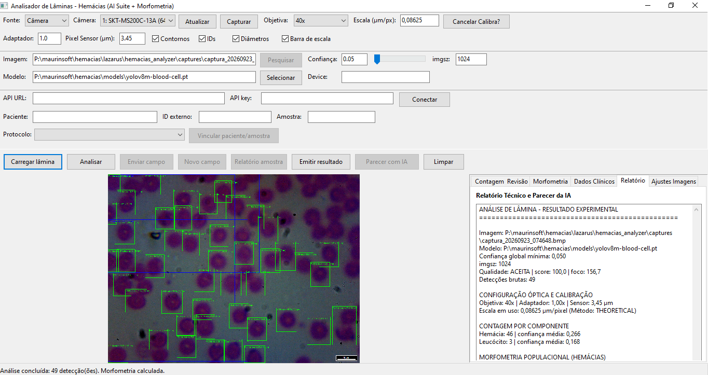

> **Projeto experimental e educacional.** Nenhum resultado produzido aqui substitui o hemograma automatizado nem a conferência de um profissional habilitado. A contagem automática precisa ser validada contra um método de referência antes de qualquer uso laboratorial ou diagnóstico.

O artigo que deu origem ao trabalho está em <https://maurinsoft.com.br/projeto-contagem-de-hemacias/>.

## Documentação

| Documento | Para quem | Conteúdo |
|---|---|---|
| [Manual do usuário](docs/MANUAL_USUARIO.md) | Quem vai operar o sistema | Instalação, uso do Hemácias Analyzer passo a passo, painel web, solução de problemas |
| [Guia técnico](docs/GUIA_TECNICO.md) | Quem desenvolve ou treina modelos | Linha de comando, treinamento YOLO, preparação do dataset, avaliação e validação |
| [Aplicativo Lazarus](lazarus/hemacias_analyzer/README.md) | Quem compila o aplicativo | Requisitos, compilação e unidades Pascal |
| [Gerenciador web](web/README.md) | Quem hospeda o painel | Instalação PHP/MySQL, API, segurança e migrações |
| [Modelos](models/README.md) | Quem escolhe o modelo de IA | Modelos incluídos, classes e métricas |
| [Auditoria do dataset](docs/DATASET_AUDIT.md) | Quem anota imagens | Cobertura atual das anotações e pendências |
| [Plano de melhorias](docs/PLANO_MELHORIAS.md) | Quem planeja a evolução | Fases previstas e prioridades |

## O que o projeto contém

| Parte | Pasta | O que faz |
|---|---|---|
| **Hemácias Analyzer** | `lazarus/hemacias_analyzer/`, `bin/` | Aplicativo de mesa para Windows: carrega ou captura a imagem da lâmina, conta por classe com YOLO, mede cada célula, calibra a escala e envia o resultado ao servidor |
| **Contador em tempo real** | `teste04.py`, `hemacias/` | Programa Python de linha de comando que conta ao vivo pela câmera do microscópio, com três métodos: Hough, Watershed e YOLO |
| **Gerenciador web** | `web/` | Painel PHP/MySQL com pacientes, amostras, contagens, imagens, revisão de anotações, dataset de treino e cadastro de modelos |
| **Ferramentas de treino e avaliação** | `tools/` | Conversão LabelMe → YOLO, treinamento, verificação do dataset e comparação com contagem manual |
| **Modelos de IA** | `models/` | Modelos YOLO prontos para hemácias, leucócitos e plaquetas |
| **Imagens de exemplo** | `esfregaco/`, `fotos/` | Esfregaços, recortes de células e anotações LabelMe |

### Como as partes se ligam

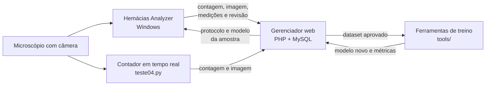

O aplicativo e o contador funcionam sozinhos. O gerenciador web é opcional e entra quando se quer guardar o histórico por paciente e amostra, revisar as detecções e montar o dataset de treino.

## Fotos

### Hemácias Analyzer

| Lâmina carregada, com réguas em µm | Controle de qualidade recusando um campo |
|---|---|
| 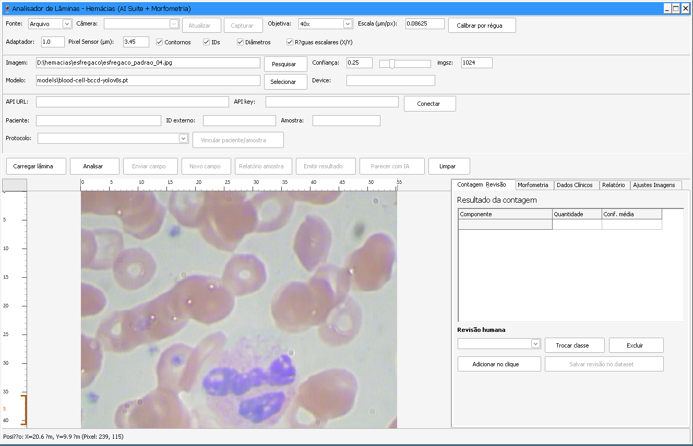 | 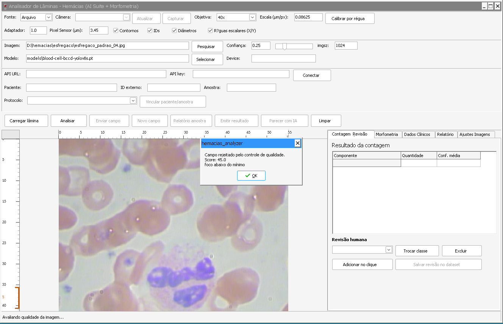 |

| Calibração por régua micrométrica | Morfometria por célula |
|---|---|
| 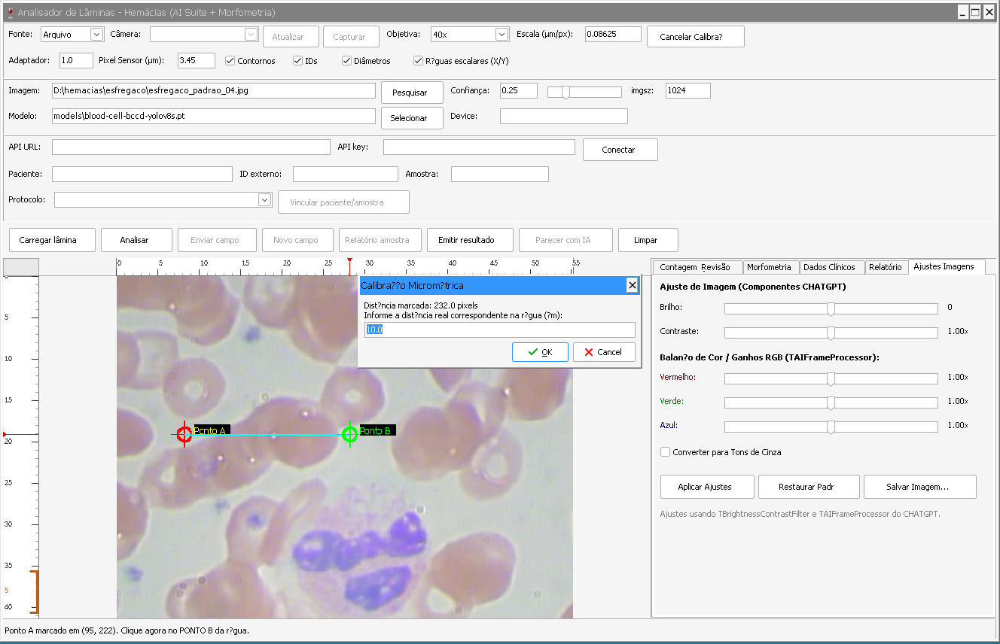 | 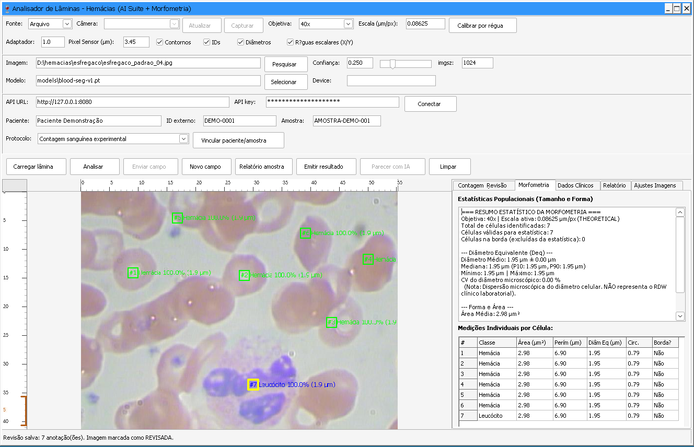 |

| Índices hematológicos (VCM, HCM, CHCM) | Revisão humana salva no servidor |
|---|---|
| 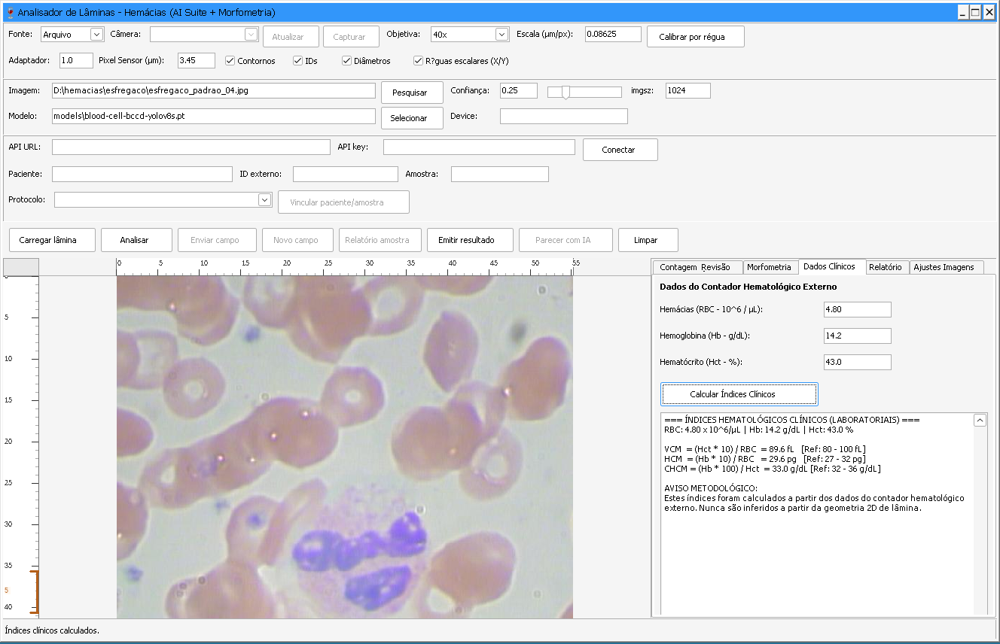 | 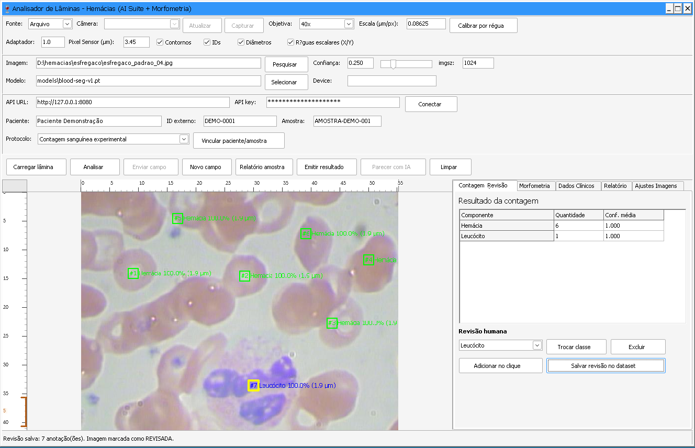 |

### Gerenciador web

| Amostra com contagens e imagens | Consolidação dos campos da amostra |
|---|---|
| 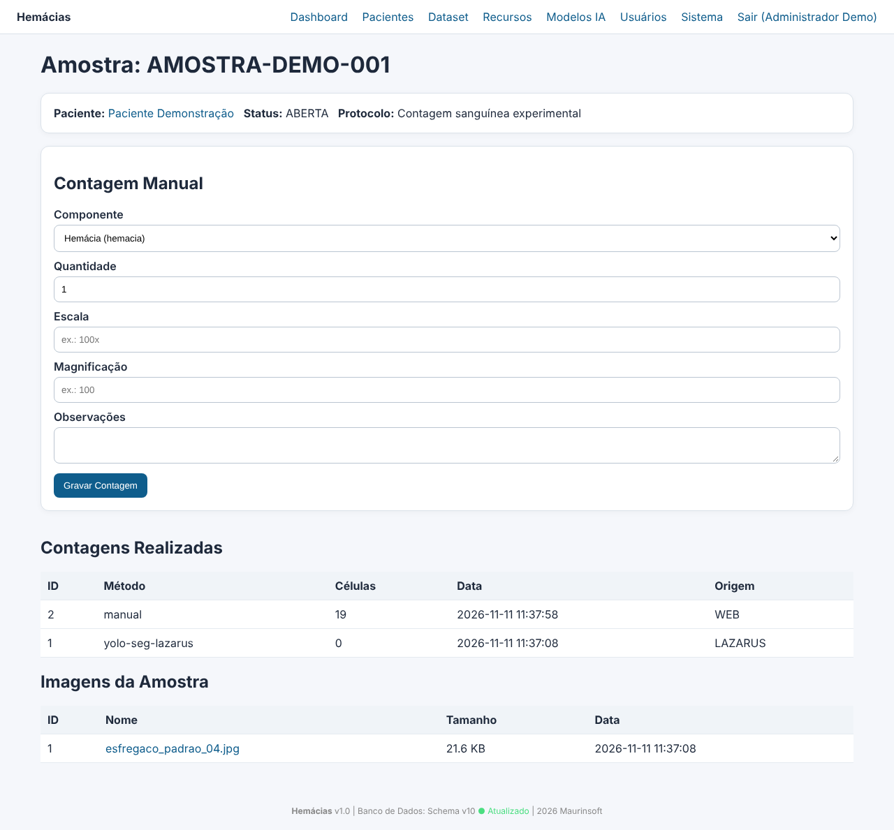 | 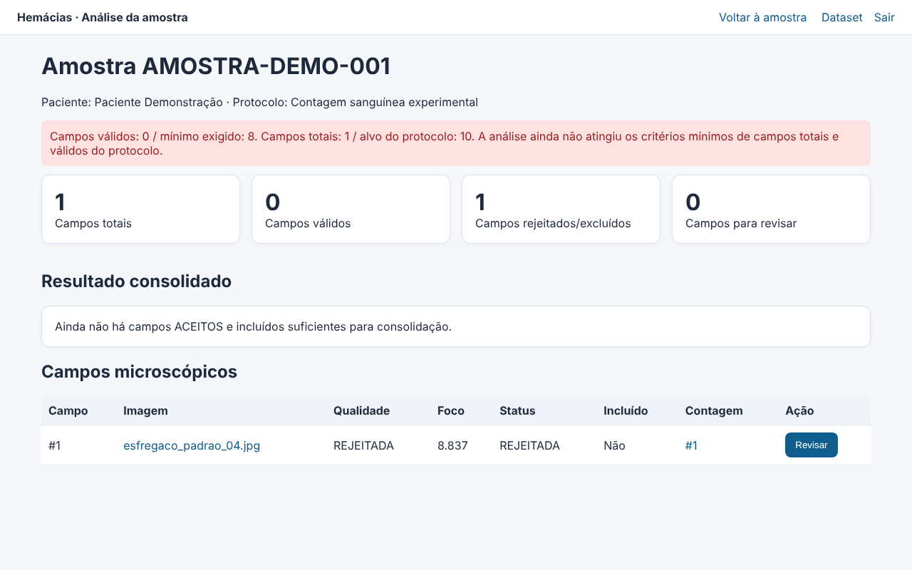 |

| Gerenciador de dataset | Anotação de imagem |
|---|---|
| 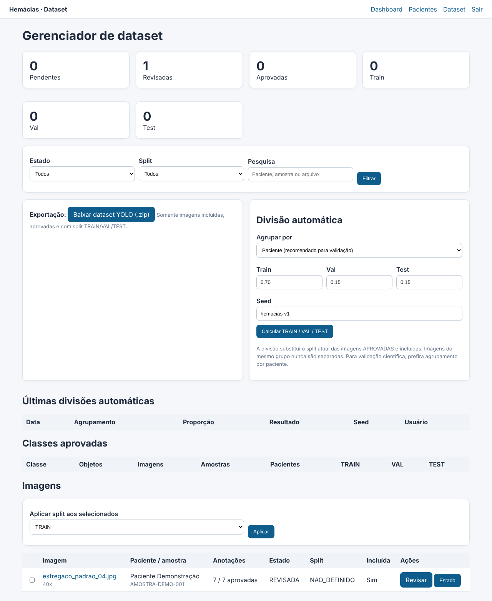 | 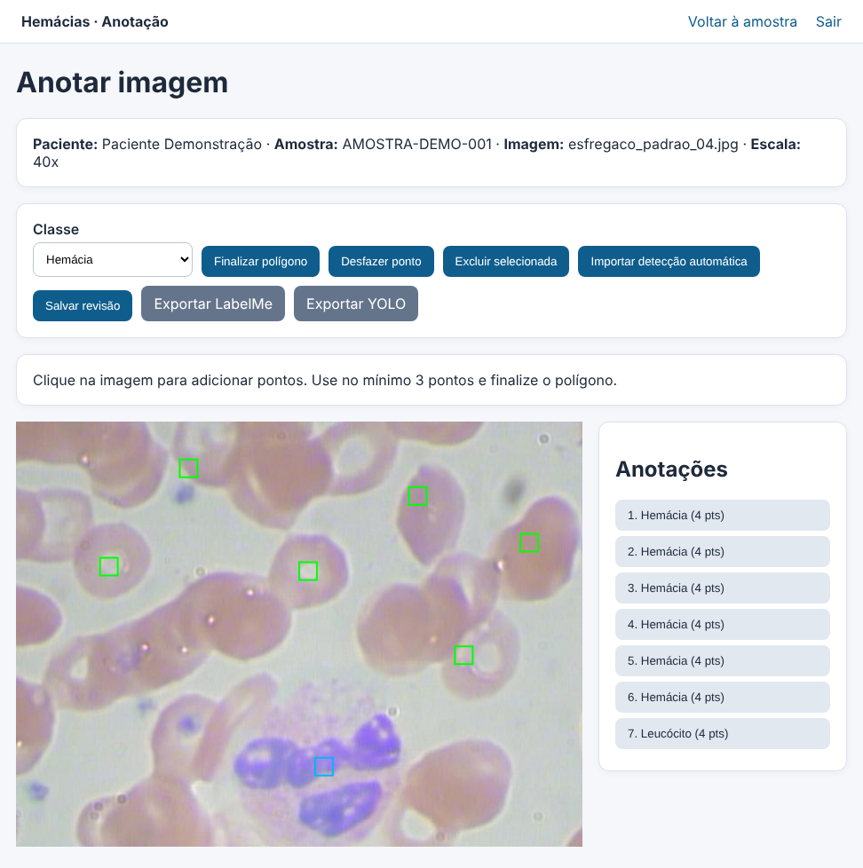 |

### Imagens de microscopia do repositório

| Esfregaço de exemplo (`esfregaco/`) | Captura do microscópio do projeto (`fotos/captura.JPG`) |
|---|---|
| 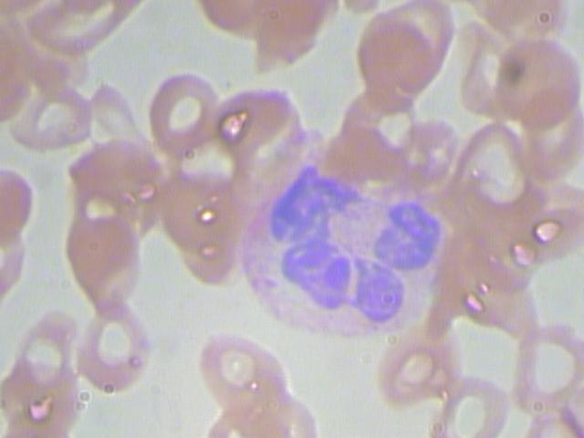 | 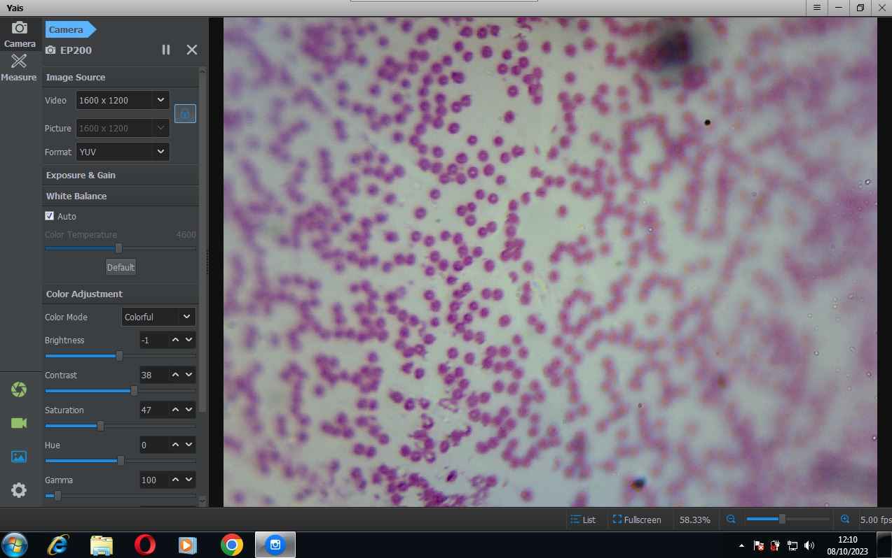 |

As telas acima usam um paciente e uma amostra fictícios, criados só para a documentação.

## Começo rápido

### 1. Aplicativo para Windows

1. Baixe e execute [`bin/HemaciasAnalyzer_Setup_v1.2.exe`](bin/HemaciasAnalyzer_Setup_v1.2.exe).
2. Instale o Python 3.10 ou superior, marcando a opção de adicioná-lo ao PATH.
3. Rode o atalho **Instalar Dependencias de IA e Camera (Python)** criado no menu Iniciar.
4. Abra o **Hemacias Analyzer**, clique em **Carregar lâmina**, escolha a imagem e clique em **Analisar**.

O passo a passo completo, com fotos de cada tela, está no [Manual do usuário](docs/MANUAL_USUARIO.md).

### 2. Contador em tempo real (Python)

Requer Python 3.10 ou superior.

```bash
python -m venv .venv
```

Windows:

```bat
.venv\Scripts\activate
pip install -r requirements.txt
```

Linux:

```bash
source .venv/bin/activate
pip install -r requirements.txt
```

Para usar o método YOLO, instale também as dependências de IA:

```bash
pip install -r requirements-ml.txt
```

Uso básico:

```bash
python teste04.py --list-videos          # lista as câmeras
python teste04.py                        # câmera padrão, método watershed
python teste04.py --index 1              # outra câmera
python teste04.py --method hough         # método anterior, para comparação
python teste04.py --method yolo --model models/blood-cell-bccd-yolov8s.pt
```

Durante a execução: `Q` encerra, `C` limpa o histórico da contagem estabilizada e `S` envia o quadro e a contagem ao gerenciador web, quando a API está configurada. Todas as opções estão no [Guia técnico](docs/GUIA_TECNICO.md#contador-em-tempo-real).

### 3. Gerenciador web

Requer PHP 8.1 ou superior e MySQL.

1. Copie `web/config.example.php` para `web/config.php`.
2. Preencha as credenciais do banco, a `api_key` e a `install_key`.
3. Dê permissão de escrita a `web/uploads/`.
4. Abra `install.php` no navegador, clique em **Instalar Banco Automaticamente** e crie o primeiro administrador.
5. Entre por `index.php`.

Detalhes em [`web/README.md`](web/README.md) e no [capítulo do painel web no manual](docs/MANUAL_USUARIO.md#11-gerenciador-web).

## Estrutura do repositório

```text
hemacias/
├── README.md                 esta página
├── teste04.py                contador em tempo real (aplicação principal em Python)
├── teste03.py                experimento antigo, mantido para comparação
├── requirements.txt          dependências básicas (OpenCV, NumPy, Pillow)
├── requirements-ml.txt       dependências de IA (Ultralytics/YOLO)
├── instalar_dependencias.bat instalador das dependências Python no Windows
├── installer_v1.0.iss        roteiros Inno Setup dos instaladores
├── installer_v1.2.iss
├── bin/                      instaladores prontos do Hemácias Analyzer
├── hemacias/                 núcleo Python
│   ├── camera.py             descoberta e abertura de câmeras
│   ├── counter.py            método Hough, foco e estabilização da contagem
│   ├── watershed.py          segmentação clássica com watershed
│   ├── yolo_counter.py       contagem multiclasse com YOLO
│   ├── quality.py            controle de qualidade da imagem
│   └── api_client.py         cliente da API do gerenciador web
├── python/
│   ├── camera_capture.py     listagem e captura de câmeras por linha de comando
│   └── tools/converte/       conversor de imagens do dataset
├── lazarus/hemacias_analyzer/  código-fonte do aplicativo de mesa
├── web/                      gerenciador PHP/MySQL e API
├── tools/                    conversão, treino, auditoria e avaliação
├── models/                   modelos YOLO
├── esfregaco/                imagens de esfregaço para teste
├── fotos/                    recortes de células e anotações LabelMe
├── datasets/                 destino dos datasets convertidos (vazio no repositório)
├── tests/                    testes do núcleo
└── docs/                     manual, guia técnico, plano e fotos
```

## Modelos incluídos

| Arquivo | Tarefa | Classes | Indicação |
|---|---|---|---|
| `blood-cell-bccd-yolov8n.pt` | Detecção | RBC, WBC, Platelets | Leve, para computador sem placa de vídeo |
| `blood-cell-bccd-yolov8s.pt` | Detecção | RBC, WBC, Platelets | Equilíbrio entre velocidade e sensibilidade |
| `blood-cell-bccd-yolov8m.pt` | Detecção | RBC, WBC, Platelets | Maior, para campos com muitas células |
| `blood-seg-v1.pt` (igual a `best.pt`) | Segmentação | hemacia | Treinado com as anotações do próprio projeto |

Os demais arquivos `yolo11*` e `yolov8*-seg` são modelos-base da Ultralytics, usados como ponto de partida de treinamento. As métricas e a origem de cada modelo estão em [`models/README.md`](models/README.md).

## Dataset

O repositório traz recortes de células em `fotos/`, com anotações LabelMe da classe `hemacia` em `fotos/positivas cinza treino/`. Hoje só esse conjunto tem rótulos utilizáveis para treino; os conjuntos de teste e as imagens coloridas ainda não têm anotação. A situação detalhada está em [`docs/DATASET_AUDIT.md`](docs/DATASET_AUDIT.md), e o caminho para converter, verificar e treinar está no [Guia técnico](docs/GUIA_TECNICO.md#segmentação-supervisionada-com-yolo).

## Testes

Os testes do núcleo ficam em `tests/` e usam o pytest:

```bash
pip install pytest
python -m pytest tests
```

## Situação atual e limites

- Os métodos Hough e Watershed contam apenas hemácias. O método YOLO conta todas as classes que o modelo conhece.
- O controle de qualidade recusa imagens fora de foco, muito escuras, muito claras ou com iluminação desigual, em vez de contar em silêncio.
- A escala em µm depende da calibração de cada conjunto de microscópio, objetiva e câmera.
- O coeficiente de variação do diâmetro, medido na imagem, não é o RDW do hemograma. VCM, HCM e CHCM só são calculados a partir de valores digitados de um contador hematológico externo.
- O painel web guarda dados de pacientes. Em produção, use HTTPS, contas com o menor privilégio possível e nunca coloque dados reais no repositório.

## Autor

Marcelo Maurin Martins — [maurinsoft.com.br](https://maurinsoft.com.br)

O aplicativo de mesa usa os componentes de IA para Lazarus do repositório [`marcelomaurin/CHATGPT`](https://github.com/marcelomaurin/CHATGPT).

## Licença

O projeto ainda não tem licença definida. Defina uma antes de distribuir ou reutilizar o código fora do projeto.
