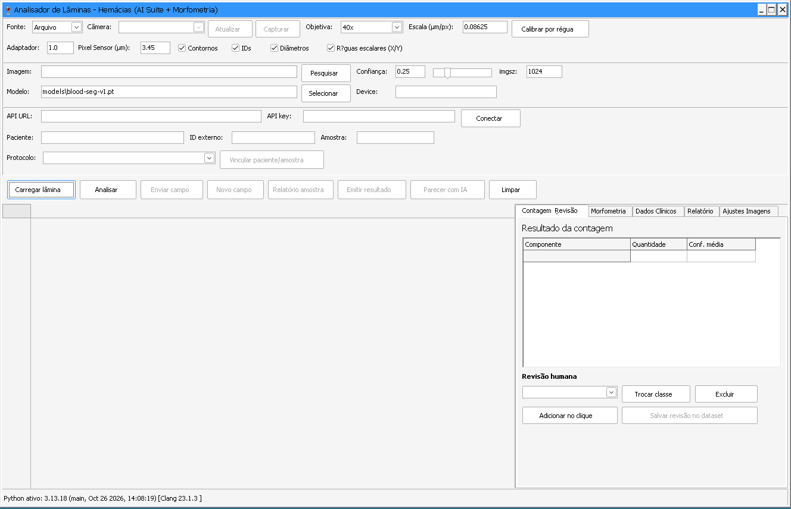
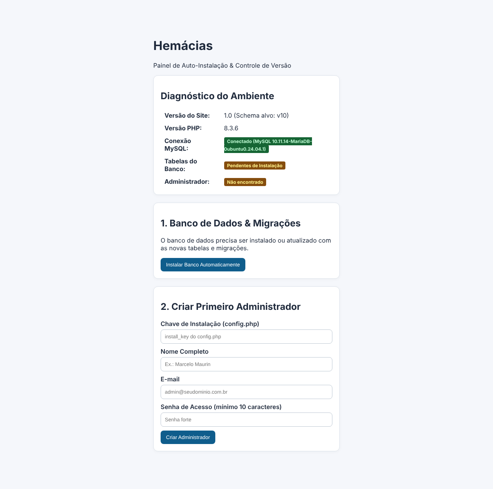
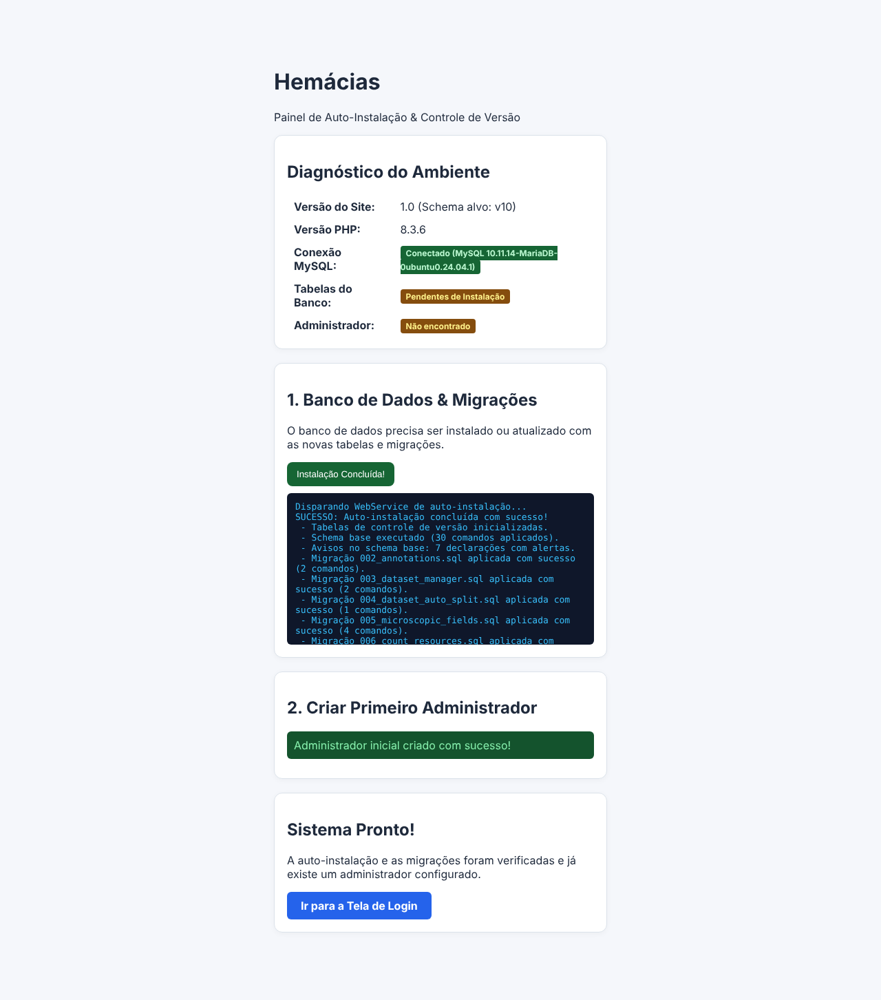

# Instalação — Hemácias

Este documento reúne tudo o que diz respeito a instalar o sistema. Para aprender a usar, veja o [Manual do usuário](MANUAL_USUARIO.md).

O Hemácias tem três partes, e cada uma se instala separadamente. Instale só o que for usar.

| Parte | Para que serve | Seção |
|---|---|---|
| Aplicativo para Windows | Analisar imagens de lâmina | [1](#1-aplicativo-para-windows) |
| Painel do navegador | Guardar pacientes, amostras e resultados | [2](#2-painel-do-navegador) |
| Contador por linha de comando | Contar ao vivo pela câmera, com Python | [3](#3-contador-por-linha-de-comando) |

---

## 1. Aplicativo para Windows

### 1.1 O que é preciso

- Computador com Windows.
- Python 3.10 ou superior.
- Internet na primeira instalação, para baixar as bibliotecas.
- Opcional: microscópio com câmera reconhecida pelo Windows. Sem câmera, o aplicativo abre imagens salvas em arquivo.

### 1.2 Instalar o programa

1. Baixe [`bin/HemaciasAnalyzer_Setup_v1.2.exe`](../bin/HemaciasAnalyzer_Setup_v1.2.exe) e execute.
2. Escolha o idioma e avance pelo assistente. A pasta padrão é `Maurinsoft\HemaciasAnalyzer`, dentro de Arquivos de Programas.
3. Se quiser, marque a criação do ícone na área de trabalho.
4. Conclua. Na última tela há uma opção para instalar as bibliotecas Python em seguida; ela vem desmarcada.

O instalador copia o programa, os modelos de IA e a documentação. Se o Python não estiver no computador, ele avisa ao final.

### 1.3 Instalar o Python

1. Baixe o Python 3.10 ou superior em <https://www.python.org/downloads/>.
2. Na primeira tela do instalador do Python, marque **Add python.exe to PATH**. Sem isso, o aplicativo não encontra o Python.
3. Conclua a instalação.

### 1.4 Instalar as bibliotecas

1. No menu Iniciar, abra **Maurinsoft → Hemacias Analyzer → Instalar Dependencias de IA e Camera (Python)**.
2. Aguarde a janela preta trabalhar. Ela instala PyTorch (versão para processador), Ultralytics, OpenCV, NumPy e Pillow. O download é grande e pode demorar.
3. Quando aparecer **INSTALACAO DE DEPENDENCIAS CONCLUIDA**, pressione uma tecla para fechar.

### 1.5 Conferir

Abra o **Hemacias Analyzer** e olhe a barra na parte de baixo da janela:

| Mensagem | Situação |
|---|---|
| `Python ativo: 3.x.x …` | Instalação correta |
| `Python indisponível` | O Python não foi encontrado; refaça 1.3 e 1.4 |
| `Erro ao inicializar Python` | Veja o motivo na aba **Relatório** |



### 1.6 Problemas comuns

| Problema | Solução |
|---|---|
| A janela de dependências diz que o Python não foi encontrado | Reinstale o Python marcando **Add python.exe to PATH** |
| `Python indisponível` mesmo com o Python instalado | Feche e reabra o aplicativo; confira no Prompt de Comando se `python --version` responde |
| `Falha na análise` na primeira contagem | As bibliotecas não foram instaladas; rode de novo o passo 1.4 |
| `Modelo não encontrado` | Clique em **Selecionar** e escolha um arquivo `.pt` da pasta `models`, dentro da pasta do programa |
| `Nenhuma câmera encontrada` | Feche o programa do fabricante da câmera, confira o cabo e clique em **Atualizar** |

### 1.7 Atualizar ou remover

- **Atualizar:** execute o instalador da versão nova por cima da anterior.
- **Remover:** use **Desinstalar Hemacias Analyzer** no menu Iniciar ou o painel de aplicativos do Windows. As bibliotecas Python e o próprio Python não são removidos.

---

## 2. Painel do navegador

O painel é instalado em um servidor e acessado pelo navegador. Esta parte é para quem administra o servidor.

### 2.1 O que é preciso

- PHP 8.1 ou superior, com as extensões PDO MySQL e FileInfo.
- Extensão ZipArchive, para exportar o dataset.
- MySQL 5.7 ou 8.0, com um banco vazio e um usuário com acesso a ele.
- HTTPS, quando o painel guardar dados reais de pacientes.

### 2.2 Passo a passo

1. Copie a pasta `web/` para o servidor.
2. Copie `web/config.example.php` para `web/config.php`.
3. Edite `config.php`:

   | Item | O que colocar |
   |---|---|
   | `dsn`, `user`, `password` | Endereço, nome do banco, usuário e senha do MySQL |
   | `base_url` | Endereço público da pasta `web` |
   | `api_key` | Uma chave longa e aleatória; é a que o aplicativo usa para enviar resultados |
   | `install_key` | Outra chave, usada uma única vez para criar o administrador |

   Em hospedagens compartilhadas, use `host=localhost` e inclua o prefixo da conta no nome do banco e do usuário.

4. Dê permissão de escrita à pasta `web/uploads/`.
5. Abra `install.php` no navegador.

   

6. Clique em **Instalar Banco Automaticamente**. As tabelas são criadas sem precisar importar arquivos à mão.
7. Em **Criar Primeiro Administrador**, informe a `install_key`, o nome, o e-mail e uma senha de pelo menos 10 caracteres.

   

8. Clique em **Ir para a Tela de Login** e entre.

### 2.3 Ligar o aplicativo ao painel

No Hemácias Analyzer, preencha **API URL** com o endereço da pasta `web` e **API key** com a `api_key` do `config.php`, e clique em **Conectar**.

### 2.4 Atualizar

Depois de copiar uma versão nova dos arquivos, entre como administrador, abra **Sistema** e clique em **Verificar / Reaplicar Migrações**. O rodapé mostra **Atualização Pendente** enquanto houver algo a aplicar.

### 2.5 Segurança

- Nunca coloque o `config.php` no repositório: ele contém senhas e chaves.
- Use HTTPS em produção.
- Use uma conta MySQL exclusiva, com o menor privilégio possível.
- Troque a `api_key` de tempos em tempos e não reutilize a `install_key`.
- Mantenha cópias de segurança protegidas.

### 2.6 Problemas comuns

| Problema | Solução |
|---|---|
| `Arquivo web/config.php não encontrado` | Faça o passo 2 |
| Diagnóstico mostra falha de conexão com o MySQL | Confira `dsn`, usuário e senha no `config.php` |
| A tela de entrada avisa que o banco não foi inicializado | Abra `install.php` e faça o passo 6 |
| Imagens não são gravadas | Confira a permissão de escrita em `web/uploads/` |
| Exportação do dataset falha | Ative a extensão ZipArchive do PHP |

Mais detalhes sobre a API e as migrações estão em [`web/README.md`](../web/README.md).

---

## 3. Contador por linha de comando

Para contar ao vivo com Python, sem o aplicativo de mesa. Funciona em Windows e Linux.

### 3.1 O que é preciso

- Python 3.10 ou superior.
- Uma câmera.

### 3.2 Passo a passo

Na pasta do projeto, crie um ambiente isolado:

```bash
python -m venv .venv
```

Ative e instale. No Windows:

```bat
.venv\Scripts\activate
pip install -r requirements.txt
```

No Linux:

```bash
source .venv/bin/activate
pip install -r requirements.txt
```

Para usar os modelos de IA, instale também:

```bash
pip install -r requirements-ml.txt
```

### 3.3 Conferir

```bash
python teste04.py --list-videos
```

O comando deve listar as câmeras encontradas. Para iniciar a contagem:

```bash
python teste04.py
```

As opções estão no [Guia técnico](GUIA_TECNICO.md#contador-em-tempo-real).

---

## 4. Compilar o aplicativo a partir do código

Só é necessário para quem vai alterar o programa. Requer o Lazarus com os pacotes da biblioteca [`marcelomaurin/CHATGPT`](https://github.com/marcelomaurin/CHATGPT). As instruções estão em [`lazarus/hemacias_analyzer/README.md`](../lazarus/hemacias_analyzer/README.md).
