# Manual do usuário — Hemácias

Este manual ensina a instalar e usar o sistema Hemácias: o aplicativo **Hemácias Analyzer** para Windows, o **gerenciador web** e o **contador em tempo real** por linha de comando.

Versão de referência: Hemácias Analyzer 1.2.

> **Leia antes de usar.** O Hemácias é um sistema experimental, voltado a pesquisa, ensino e testes. Os resultados não substituem o hemograma automatizado e não dispensam a conferência de um profissional habilitado. Não use a contagem para decisão clínica sem validação formal.

## Sumário

1. [Visão geral](#1-visão-geral)
2. [O que você precisa](#2-o-que-você-precisa)
3. [Instalação](#3-instalação)
4. [Conhecendo a tela](#4-conhecendo-a-tela)
5. [Primeira análise, passo a passo](#5-primeira-análise-passo-a-passo)
6. [Controle de qualidade da imagem](#6-controle-de-qualidade-da-imagem)
7. [Escala e calibração](#7-escala-e-calibração)
8. [Lendo os resultados](#8-lendo-os-resultados)
9. [Revisão humana](#9-revisão-humana)
10. [Trabalhando com paciente, amostra e servidor](#10-trabalhando-com-paciente-amostra-e-servidor)
11. [Gerenciador web](#11-gerenciador-web)
12. [Contador em tempo real](#12-contador-em-tempo-real)
13. [Solução de problemas](#13-solução-de-problemas)
14. [Glossário](#14-glossário)
15. [Limites do sistema](#15-limites-do-sistema)

---

## 1. Visão geral

O sistema tem três partes, que podem ser usadas juntas ou separadas.

| Parte | Onde roda | Para que serve |
|---|---|---|
| **Hemácias Analyzer** | Computador com Windows, ligado ao microscópio | Analisar uma imagem de lâmina por vez: contar, medir, revisar e emitir o resultado |
| **Gerenciador web** | Servidor com PHP e MySQL | Guardar pacientes, amostras, contagens e imagens; revisar anotações; montar o dataset de treino |
| **Contador em tempo real** | Qualquer computador com Python | Contar ao vivo, direto da câmera, por linha de comando |

O caminho mais comum é este:

1. colocar a lâmina no microscópio e capturar a imagem de um campo;
2. analisar a imagem no Hemácias Analyzer;
3. conferir e corrigir as detecções;
4. enviar o campo ao servidor;
5. repetir para os demais campos da mesma amostra;
6. consultar o resultado consolidado da amostra.

Quem não usa o servidor para no passo 3 e grava o resultado em arquivo.

As telas deste manual foram feitas com um paciente e uma amostra fictícios ("Paciente Demonstração", "AMOSTRA-DEMO-001") e com a imagem `esfregaco/esfregaco_padrao_04.jpg` do repositório. A moldura das janelas pode ser diferente no seu Windows.

## 2. O que você precisa

### Para o Hemácias Analyzer

- Computador com Windows.
- Python 3.10 ou superior, instalado com a opção **Add python.exe to PATH** marcada.
- Acesso à internet na primeira instalação, para baixar as bibliotecas Python (OpenCV, NumPy, Pillow, PyTorch e Ultralytics).
- Para captura direta: microscópio com câmera reconhecida pelo Windows. Sem câmera, o aplicativo trabalha com imagens salvas em arquivo (`.png`, `.jpg`, `.jpeg`, `.bmp`, `.webp`).
- Para a calibração por régua: uma lâmina micrométrica.

### Para o gerenciador web

- Servidor com PHP 8.1 ou superior e MySQL.
- Extensões PHP PDO MySQL e FileInfo; a extensão ZipArchive é necessária para exportar o dataset.
- HTTPS, quando o painel guardar dados reais.

### Para o contador em tempo real

- Python 3.10 ou superior e uma câmera.

## 3. Instalação

O roteiro completo, incluindo o painel do navegador, o contador em Python e os problemas mais comuns, está em [Instalação](INSTALACAO.md). Abaixo vai o essencial do aplicativo.

### 3.1 Instalar o Hemácias Analyzer

1. Execute `HemaciasAnalyzer_Setup_v1.2.exe`, que está na pasta `bin/` do repositório.
2. Escolha o idioma e siga o assistente. A pasta padrão é `Maurinsoft\HemaciasAnalyzer`, dentro de Arquivos de Programas.
3. Se quiser, marque a criação do ícone na área de trabalho.
4. Na última tela, marque **Instalar/Atualizar dependências Python** para já baixar as bibliotecas, ou deixe para o passo 3.2.

O instalador copia o programa, os modelos de IA, o utilitário de câmera e esta documentação. Se o Python não for encontrado, o instalador avisa ao final.

### 3.2 Instalar as dependências Python

1. Instale o Python 3.10 ou superior a partir de <https://www.python.org/downloads/>, marcando **Add python.exe to PATH**.
2. No menu Iniciar, abra **Maurinsoft → Hemacias Analyzer → Instalar Dependencias de IA e Camera (Python)**.
3. Aguarde a janela preta terminar. Ela atualiza o `pip` e instala PyTorch (versão para processador), Ultralytics, OpenCV, NumPy e Pillow.
4. Quando aparecer **INSTALACAO DE DEPENDENCIAS CONCLUIDA**, pressione uma tecla para fechar.

Se o Python não estiver no PATH, a janela mostra um erro e abre a página de download.

### 3.3 Conferir se está tudo certo

Abra o Hemácias Analyzer e olhe a barra de status, na parte de baixo da janela:

| Mensagem | Significado |
|---|---|
| `Python ativo: 3.x.x …` | Tudo pronto para analisar |
| `Python indisponível` | O Python não foi encontrado; refaça o passo 3.2 |
| `Erro ao inicializar Python` | Veja o motivo na aba **Relatório** |

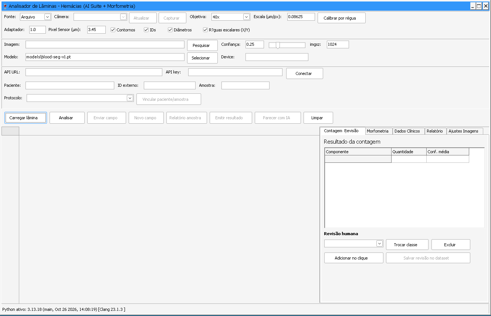

## 4. Conhecendo a tela

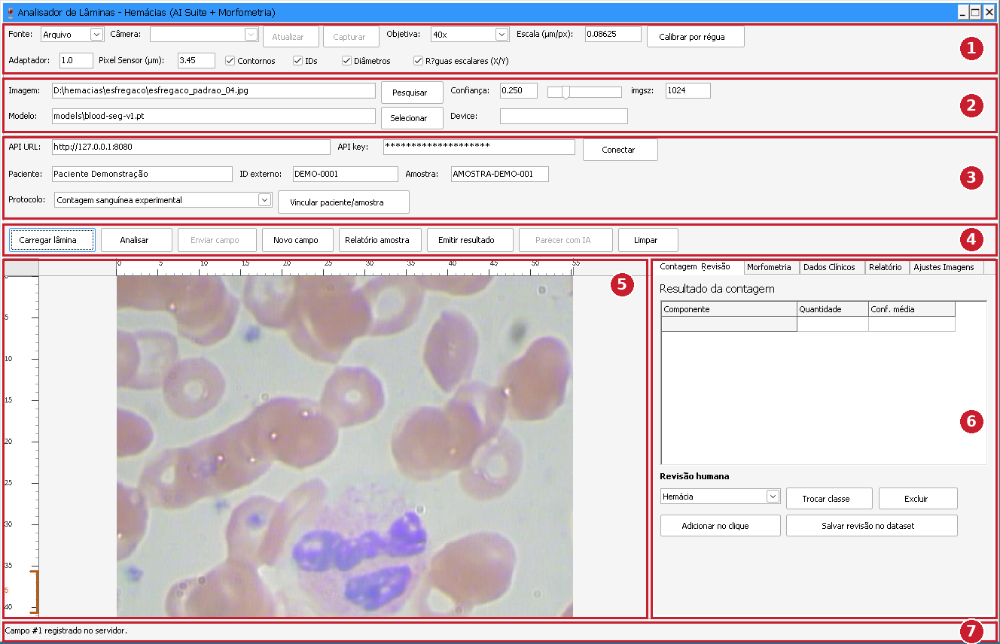

| Nº | Região | O que tem |
|---|---|---|
| 1 | **Entrada e óptica** | **Fonte** (Arquivo ou Câmera), lista de câmeras, **Atualizar**, **Capturar**, **Objetiva**, **Escala (µm/px)**, **Calibrar por régua**, **Adaptador**, **Pixel Sensor (µm)** e as caixas que ligam e desligam o que é desenhado sobre a imagem |
| 2 | **Imagem e modelo** | Caminho da imagem, **Pesquisar**, caminho do **Modelo**, **Selecionar**, **Confiança**, **imgsz** e **Device** |
| 3 | **Servidor e amostra** | **API URL**, **API key**, **Conectar**, **Paciente**, **ID externo**, **Amostra**, **Protocolo** e **Vincular paciente/amostra** |
| 4 | **Ações** | **Carregar lâmina**, **Analisar**, **Enviar campo**, **Novo campo**, **Relatório amostra**, **Emitir resultado**, **Parecer com IA** e **Limpar** |
| 5 | **Imagem** | A lâmina, com réguas em micrômetros em cima e à esquerda, e as detecções desenhadas |
| 6 | **Abas de resultado** | **Contagem & Revisão**, **Morfometria**, **Dados Clínicos**, **Relatório** e **Ajustes Imagens** |
| 7 | **Barra de status** | O que o programa está fazendo e a posição do cursor sobre a imagem, em µm e em pixels |

### Caixas de exibição

| Caixa | O que mostra |
|---|---|
| **Contornos** | O contorno de cada célula detectada |
| **IDs** | O número de cada célula, igual ao da tabela de medições |
| **Diâmetros** | O diâmetro calculado, em µm, ao lado de cada célula |
| **Réguas escalares (X/Y)** | As réguas em µm nas bordas da imagem |

### Botões que ficam apagados

Alguns botões só acendem quando fazem sentido:

| Botão | Acende quando |
|---|---|
| **Enviar campo** | Há uma análise feita e uma amostra vinculada ao servidor |
| **Novo campo** e **Relatório amostra** | Há uma amostra vinculada |
| **Emitir resultado** | Há uma análise feita |
| **Parecer com IA** | Há uma análise feita e o componente de texto por IA está configurado |
| **Salvar revisão no dataset** | O campo já foi enviado ao servidor |

## 5. Primeira análise, passo a passo

### Passo 1 — Trazer a imagem

**De um arquivo.** Deixe **Fonte** em **Arquivo**, clique em **Carregar lâmina** (ou **Pesquisar**) e escolha a imagem.

**Da câmera.** Mude **Fonte** para **Câmera**. O programa procura as câmeras ligadas e preenche a lista; se a sua não aparecer, clique em **Atualizar**. Enquadre e foque o campo no microscópio e clique em **Capturar**. O quadro é gravado na pasta `captures`, junto do programa, com data e hora no nome, e aparece na tela.

Com a imagem carregada, a barra de status mostra `Lâmina pronta para análise.` e as réguas passam a indicar o tamanho do campo em micrômetros.

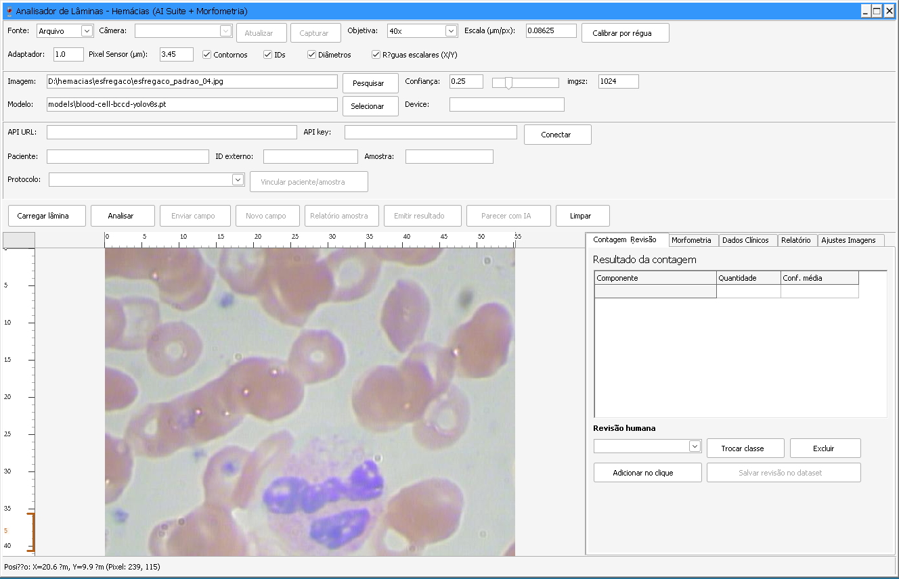

### Passo 2 — Escolher o modelo

O campo **Modelo** indica o arquivo de IA usado na contagem. Clique em **Selecionar** para trocar. Os modelos ficam na pasta `models`:

| Modelo | O que reconhece | Quando usar |
|---|---|---|
| `blood-seg-v1.pt` | Hemácias, com o contorno exato de cada uma | Quando o que importa é medir tamanho e forma das hemácias |
| `blood-cell-bccd-yolov8s.pt` | Hemácias, leucócitos e plaquetas | Contagem dos três componentes |
| `blood-cell-bccd-yolov8n.pt` | Hemácias, leucócitos e plaquetas | Computador mais lento |

Os modelos `blood-cell-bccd` marcam cada célula com um retângulo; por isso as medidas de forma saem aproximadas. O `blood-seg-v1.pt` desenha o contorno e mede com mais fidelidade, mas só conhece hemácias.

### Passo 3 — Ajustar os parâmetros

| Campo | Padrão | Para que serve |
|---|---|---|
| **Confiança** | 0.25 | Certeza mínima para aceitar uma detecção. Aumente se aparecerem células que não existem; diminua se células reais ficarem de fora. A barra ao lado faz o mesmo ajuste |
| **imgsz** | 1024 | Tamanho em que a imagem é analisada. Valores maiores enxergam células pequenas, mas demoram mais |
| **Device** | vazio | Onde o cálculo roda. Vazio escolhe sozinho; `cpu` força o processador; `0` usa a primeira placa de vídeo |
| **Objetiva** | 40x | A objetiva usada na captura. Define a escala em µm (veja o [capítulo 7](#7-escala-e-calibração)) |

### Passo 4 — Analisar

Clique em **Analisar**. O programa:

1. confere a qualidade da imagem;
2. roda o modelo;
3. conta por classe;
4. mede cada célula;
5. desenha as detecções e monta o relatório.

A primeira análise demora mais, porque o modelo precisa ser carregado. Ao final, a barra de status mostra `Análise concluída: N detecção(ões). Morfometria calculada.`

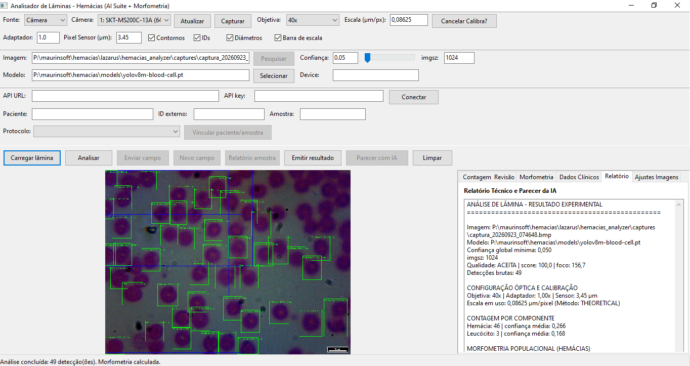

*Tela de uma análise concluída, feita no microscópio do projeto com a objetiva de 40x: 49 detecções, sendo 46 hemácias e 3 leucócitos. A captura é de uma versão anterior do programa, em que a caixa das réguas se chamava "Barra de escala".*

### Passo 5 — Guardar o resultado

Clique em **Emitir resultado** e escolha o formato:

| Formato | Conteúdo |
|---|---|
| **JSON** | O resultado completo, para outros programas lerem |
| **CSV** | Uma linha por componente: código, nome, quantidade e confiança média, separados por ponto e vírgula |
| **TXT** | O texto da aba **Relatório** |

O nome sugerido é `resultado_lamina_` seguido de data e hora.

Para começar outra imagem, clique em **Limpar**.

## 6. Controle de qualidade da imagem

Antes de contar, o programa avalia a imagem e dá uma nota de 0 a 100.

| Estado | O que acontece |
|---|---|
| **ACEITA** | A análise segue normalmente |
| **REVISAR** | A análise segue, mas o campo fica marcado para conferência |
| **REJEITADA** | A análise não é feita; o programa mostra o motivo |

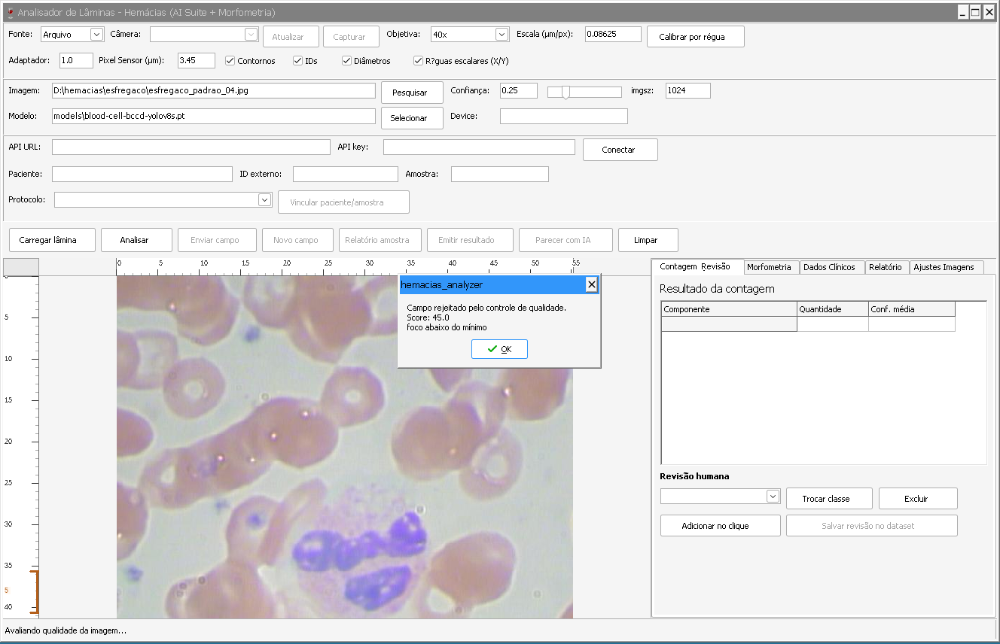

Os motivos possíveis:

| Motivo mostrado | O que fazer |
|---|---|
| `foco abaixo do mínimo` | Refaça o foco fino do microscópio e capture de novo. É o único motivo que rejeita sozinho |
| `imagem muito escura` | Aumente a iluminação ou o tempo de exposição |
| `imagem muito clara` | Reduza a iluminação ou a exposição |
| `excesso de pixels escuros/saturados` | Verifique sombras, sujeira na lente ou bordas do campo aparecendo |
| `excesso de pixels claros/saturados` | Reduza a luz; há regiões estouradas |
| `iluminação muito desigual` | Centralize e ajuste o condensador e a fonte de luz |

Mesmo rejeitado, o campo gera um relatório, que mostra a nota, o foco medido e o motivo. Se houver uma amostra vinculada, o campo rejeitado pode ser enviado ao servidor; ele fica registrado, mas fora do resultado consolidado.

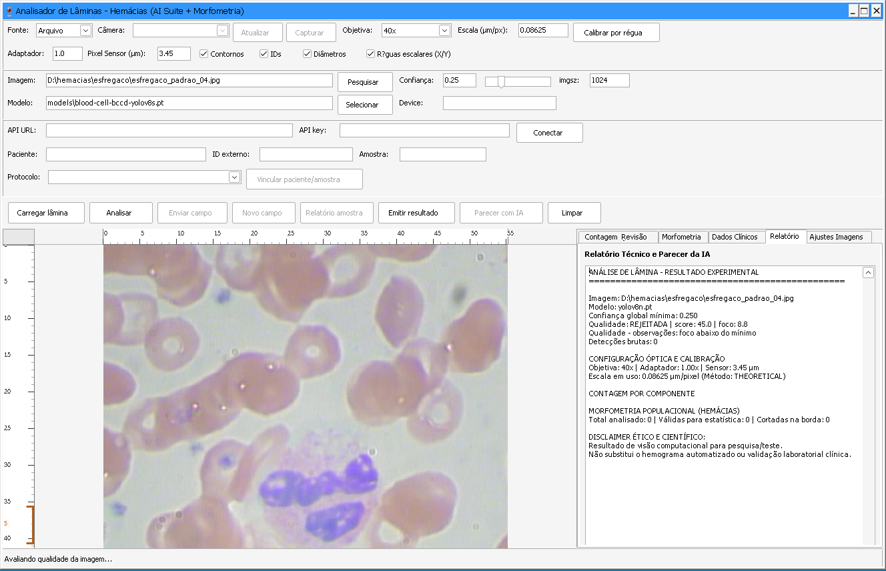

> As imagens `esfregaco_padrao_*.jpg` do repositório são pouco nítidas e são recusadas por foco. Elas servem para conhecer a tela e treinar a revisão manual, não para testar a contagem automática.

## 7. Escala e calibração

Para dar medidas em micrômetros, o programa precisa saber quanto vale cada pixel da imagem. Esse valor aparece em **Escala (µm/px)**.

### 7.1 Escala teórica

Sem calibração, a escala é calculada pela fórmula:

```text
escala (µm/px) = tamanho do pixel do sensor ÷ (aumento da objetiva × aumento do adaptador)
```

Com o padrão do programa (sensor de 3,45 µm, objetiva de 40x, adaptador de 1,0), a escala é 0,08625 µm por pixel.

Para ajustar:

1. Preencha **Pixel Sensor (µm)** com o valor da ficha técnica da sua câmera.
2. Preencha **Adaptador** com o aumento do adaptador entre o microscópio e a câmera (1.0 quando não houver).
3. Escolha a **Objetiva**: 10x, 20x, 40x ou 100x.

A escala é recalculada no momento em que a objetiva é escolhida. Se você mudar **Adaptador** ou **Pixel Sensor** depois, selecione a objetiva de novo para atualizar o valor. Digitar direto no campo **Escala** não altera o cálculo.

### 7.2 Calibração por régua micrométrica

A escala teórica é uma aproximação. Para medidas confiáveis, calibre com uma lâmina micrométrica:

1. Coloque a lâmina micrométrica no microscópio, com a mesma objetiva que será usada nas análises.
2. Capture ou carregue a imagem da régua.
3. Clique em **Calibrar por régua**. O cursor vira uma cruz.
4. Clique no **ponto A**, o início de um trecho de comprimento conhecido.
5. Clique no **ponto B**, o fim do trecho. Uma linha liga os dois pontos.
6. Na janela que abre, digite a distância real entre os pontos, em micrômetros, e confirme.

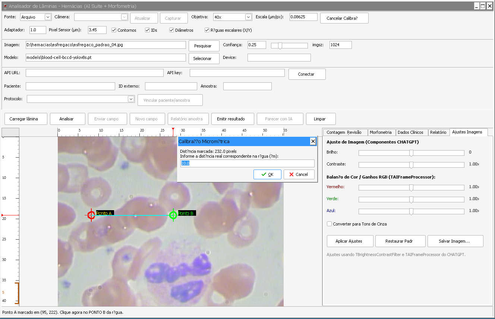

O programa calcula a nova escala, mostra o resultado e refaz todas as medidas da imagem atual.

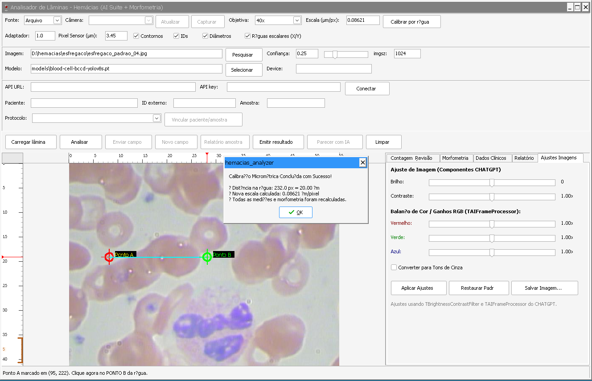

*As duas telas acima mostram só a mecânica dos cliques, sobre uma imagem de esfregaço. A calibração de verdade é feita sobre a imagem da lâmina micrométrica.*

Cuidados:

- Use o trecho mais longo que couber na imagem; pontos muito próximos (menos de 2 pixels) são recusados.
- Refaça a calibração sempre que trocar de objetiva, adaptador ou câmera.
- Para desistir no meio, clique em **Cancelar Calibração** (o mesmo botão).
- Depois de calibrada, a escala não muda mais ao trocar a objetiva na lista. O relatório indica o método em uso: `THEORETICAL` (teórica) ou `STAGE_MICROMETER` (régua).

## 8. Lendo os resultados

### 8.1 Aba Contagem & Revisão

A tabela **Resultado da contagem** traz uma linha por componente encontrado, com a quantidade e a confiança média das detecções. Abaixo ficam os controles de [revisão humana](#9-revisão-humana).

### 8.2 Aba Morfometria

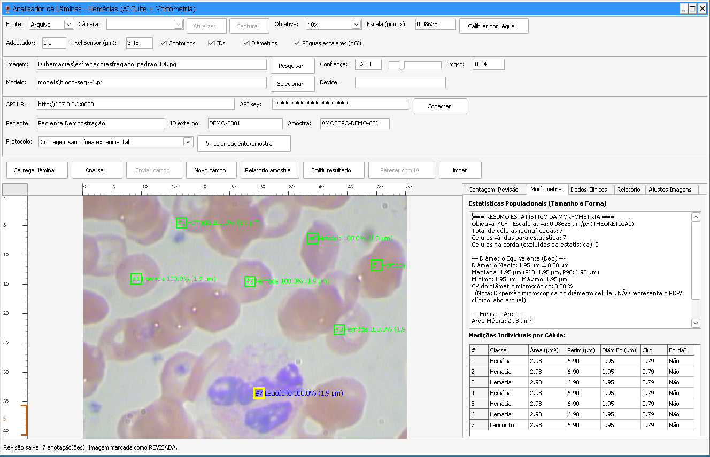

A parte de cima resume a população de células; a de baixo lista cada célula, com o mesmo número mostrado na imagem.

| Coluna | Significado |
|---|---|
| **#** | Número da célula |
| **Classe** | Hemácia, leucócito, plaqueta e assim por diante |
| **Área (µm²)** | Área da célula |
| **Perím (µm)** | Perímetro |
| **Diâm Eq (µm)** | Diâmetro do círculo que tem a mesma área da célula |
| **Circ.** | Circularidade: 1,00 é um círculo perfeito; valores menores indicam forma alongada ou irregular |
| **Borda?** | "Sim" quando a célula toca a margem da imagem e está cortada |

O resumo traz, para o diâmetro: média, desvio padrão, mediana, mínimo, máximo, percentis P10 e P90 e o coeficiente de variação (CV).

Pontos de atenção:

- As células cortadas pela borda são medidas, mas ficam fora das estatísticas, para não distorcer a distribuição de tamanhos.
- O **CV do diâmetro microscópico** mede a variação de tamanho das hemácias vistas na imagem. **Ele não é o RDW do hemograma** e não deve ser lido como tal.
- Toda medida em µm depende da escala. Sem calibração por régua, trate os valores como aproximados.

### 8.3 Aba Dados Clínicos

Esta aba calcula os índices hematológicos a partir de valores que você digita, vindos de um contador hematológico:

1. Preencha **Hemácias (RBC)**, em milhões por microlitro.
2. Preencha **Hemoglobina (Hb)**, em g/dL.
3. Preencha **Hematócrito (Hct)**, em %.
4. Clique em **Calcular Índices Clínicos**.

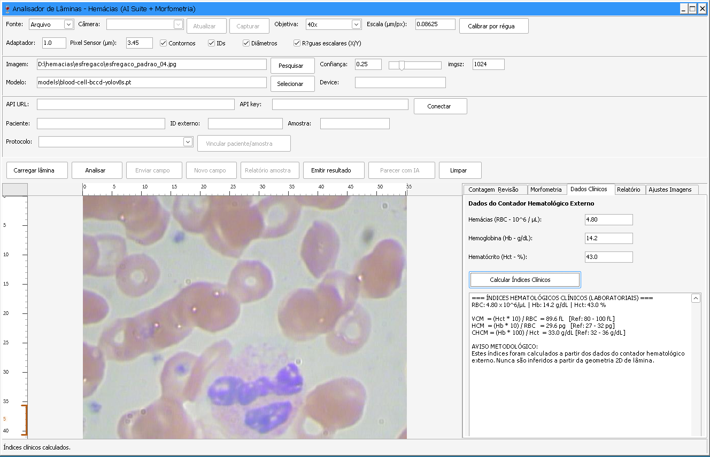

| Índice | Fórmula | Faixa mostrada como referência |
|---|---|---|
| **VCM** | (Hct × 10) ÷ RBC | 80 a 100 fL |
| **HCM** | (Hb × 10) ÷ RBC | 27 a 32 pg |
| **CHCM** | (Hb × 100) ÷ Hct | 32 a 36 g/dL |

O programa nunca estima hemoglobina, hematócrito ou VCM a partir da imagem. Os índices só existem quando você informa os três valores do laboratório. Se o campo for enviado ao servidor depois do cálculo, os dados ficam gravados na amostra.

### 8.4 Aba Relatório

Mostra o relatório técnico em texto: imagem, modelo, confiança, qualidade, configuração óptica, contagem por componente, morfometria e, se houver, os dados do laboratório. É também onde aparecem as mensagens de registro do programa (o que foi carregado, o que falhou).

O botão **Parecer com IA** acrescenta ao relatório um resumo redigido por um modelo de linguagem. Ele recebe somente os números do relatório e é instruído a não inventar contagens nem interpretação clínica. O botão só fica disponível quando o componente `TCHATGPT`, da biblioteca [`marcelomaurin/CHATGPT`](https://github.com/marcelomaurin/CHATGPT), tem uma configuração salva no computador; sem ela, a aba registra `TCHATGPT sem configuração salva; parecer textual indisponível.`

### 8.5 Aba Ajustes Imagens

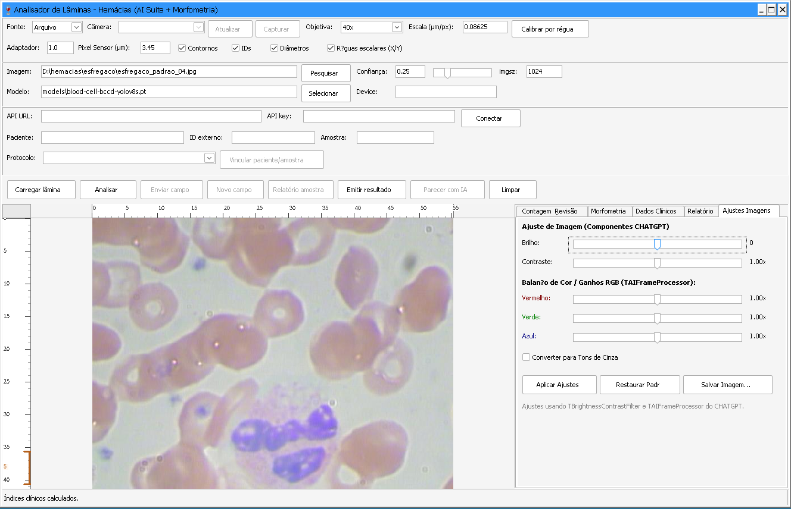

Permite melhorar a visualização da imagem carregada:

| Controle | Efeito |
|---|---|
| **Brilho** e **Contraste** | Clareiam, escurecem e realçam a imagem |
| **Vermelho**, **Verde**, **Azul** | Corrigem o balanço de cor, canal por canal |
| **Converter para Tons de Cinza** | Remove a cor |
| **Aplicar Ajustes** | Aplica os valores à imagem exibida |
| **Restaurar Padrão** | Volta aos valores originais |
| **Salvar Imagem...** | Grava a imagem ajustada em PNG, JPEG ou BMP |

## 9. Revisão humana

Nenhum modelo acerta tudo. A revisão permite corrigir o resultado antes de guardá-lo. Os controles ficam na aba **Contagem & Revisão**.

| Para | Faça |
|---|---|
| **Selecionar** uma detecção | Clique sobre ela na imagem. A barra de status mostra o número, a classe e a confiança |
| **Corrigir a classe** | Selecione a detecção, escolha a classe certa na lista e clique em **Trocar classe** |
| **Remover** um falso positivo | Selecione a detecção e clique em **Excluir** |
| **Incluir** uma célula que faltou | Escolha a classe na lista, clique em **Adicionar no clique** e depois no centro da célula |

A contagem e a morfometria são refeitas a cada correção.

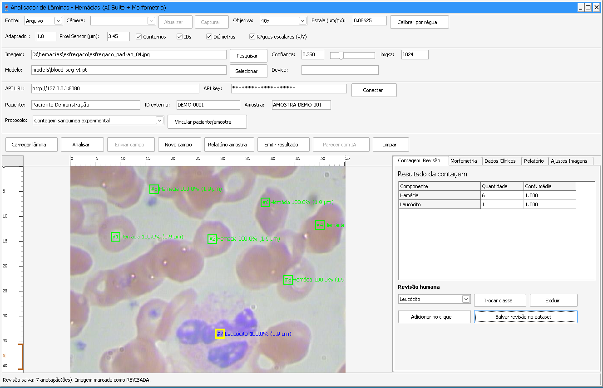

*Exemplo de revisão feita inteiramente à mão: seis hemácias e um leucócito marcados com **Adicionar no clique** e gravados no servidor.*

Uma célula incluída à mão entra como um quadrado pequeno, de tamanho fixo, centrado no clique. Ela vale para a **contagem**, mas as medidas de tamanho desse objeto não representam a célula real.

Para gravar a revisão no servidor, envie primeiro o campo ([capítulo 10](#10-trabalhando-com-paciente-amostra-e-servidor)) e depois clique em **Salvar revisão no dataset**. A imagem passa ao estado **REVISADA** no gerenciador de dataset. A contagem automática original é preservada; a correção humana é gravada à parte.

## 10. Trabalhando com paciente, amostra e servidor

Use esta parte quando houver um gerenciador web instalado ([capítulo 11](#11-gerenciador-web)).

### 10.1 Conectar

1. Em **API URL**, digite o endereço da pasta `web` do servidor, por exemplo `https://servidor/hemacias/web`.
2. Em **API key**, digite a chave de API fornecida pelo administrador (a mesma do `config.php` do servidor).
3. Clique em **Conectar**.

A barra de status mostra `API conectada.` e a lista **Protocolo** é preenchida.

### 10.2 Vincular paciente e amostra

1. Preencha **Paciente** com o nome.
2. Preencha **ID externo**, se houver (prontuário ou código do laboratório).
3. Preencha **Amostra** com o código da amostra.
4. Escolha o **Protocolo**.
5. Clique em **Vincular paciente/amostra**.

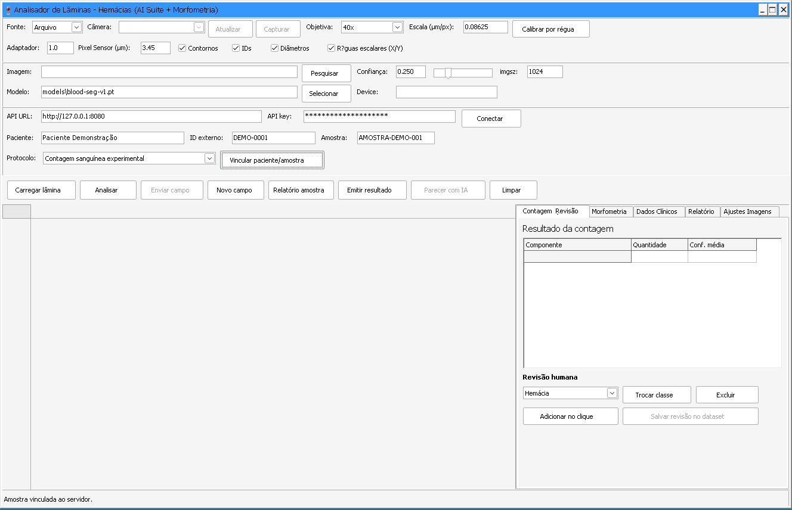

Se o paciente ou a amostra ainda não existirem, são criados. Ao vincular, o programa aplica a configuração do protocolo: modelo, tamanho de análise e limiar de confiança. Se o protocolo tiver um modelo cadastrado com assinatura (SHA-256), o programa confere se o arquivo local é exatamente o mesmo antes de analisar; se não for, avisa e não prossegue.

### 10.3 Enviar os campos

Para cada campo microscópico da amostra:

1. carregue ou capture a imagem;
2. clique em **Analisar**;
3. revise, se necessário;
4. clique em **Enviar campo**.

A barra de status confirma: `Campo #N registrado no servidor.` Vão para o servidor a imagem, a contagem por componente, as medições de cada célula, a configuração óptica e o resultado do controle de qualidade.

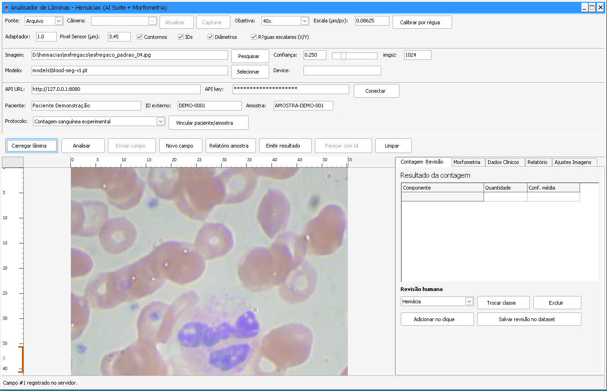

Clique em **Novo campo** para limpar a tela e seguir para o próximo, mantendo a mesma amostra.

### 10.4 Acompanhar a amostra

O botão **Relatório amostra** mostra, na aba **Relatório**, o consolidado vindo do servidor: quantos campos foram enviados, quantos são válidos, a meta do protocolo e os resultados por componente.

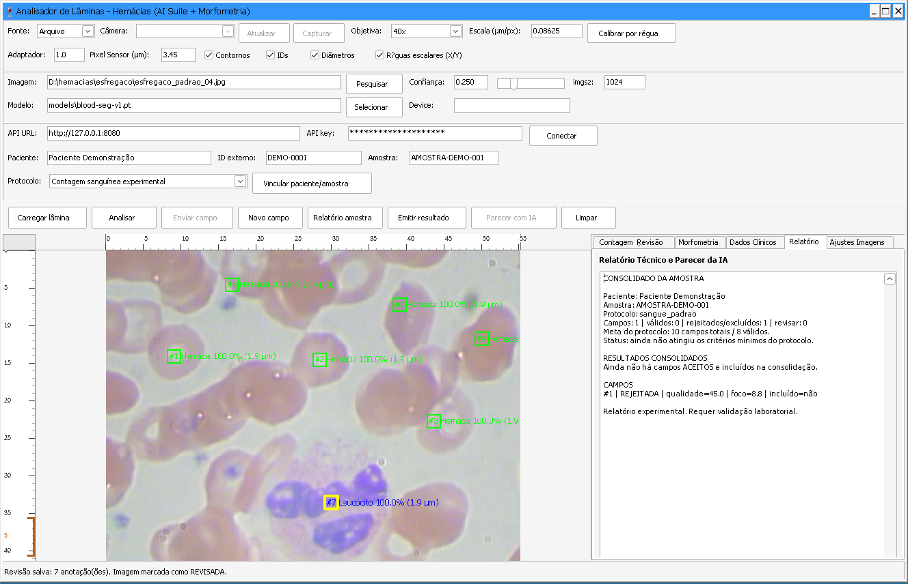

A amostra só é considerada pronta quando atinge o número total de campos e o número mínimo de campos válidos exigidos pelo protocolo. No protocolo padrão, "Contagem sanguínea experimental", são 10 campos no total e 8 válidos. Com o relatório da amostra na tela, **Emitir resultado** grava esse texto em arquivo.

## 11. Gerenciador web

O gerenciador web é o arquivo central do sistema. Ele é acessado pelo navegador.

### 11.1 Instalação (administrador)

1. Copie `web/config.example.php` para `web/config.php`.
2. Em `config.php`, preencha o banco de dados, a `api_key` (usada pelos aplicativos) e a `install_key` (usada uma única vez, na instalação).
3. Dê permissão de escrita à pasta `web/uploads/`.
4. Abra `install.php` no navegador.

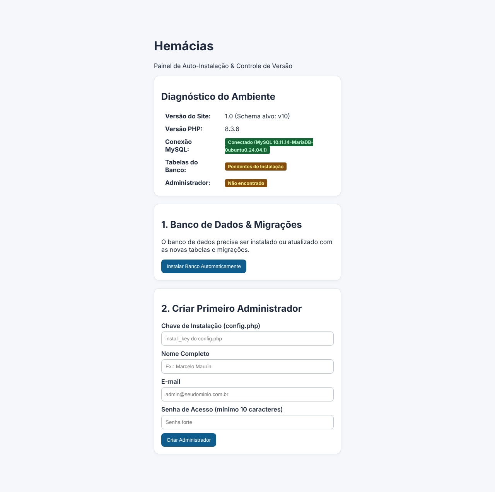

5. Clique em **Instalar Banco Automaticamente**. As tabelas e as migrações são criadas.
6. Preencha a **Chave de Instalação** (a `install_key`), o nome, o e-mail e uma senha de pelo menos 10 caracteres, e clique em **Criar Administrador**.

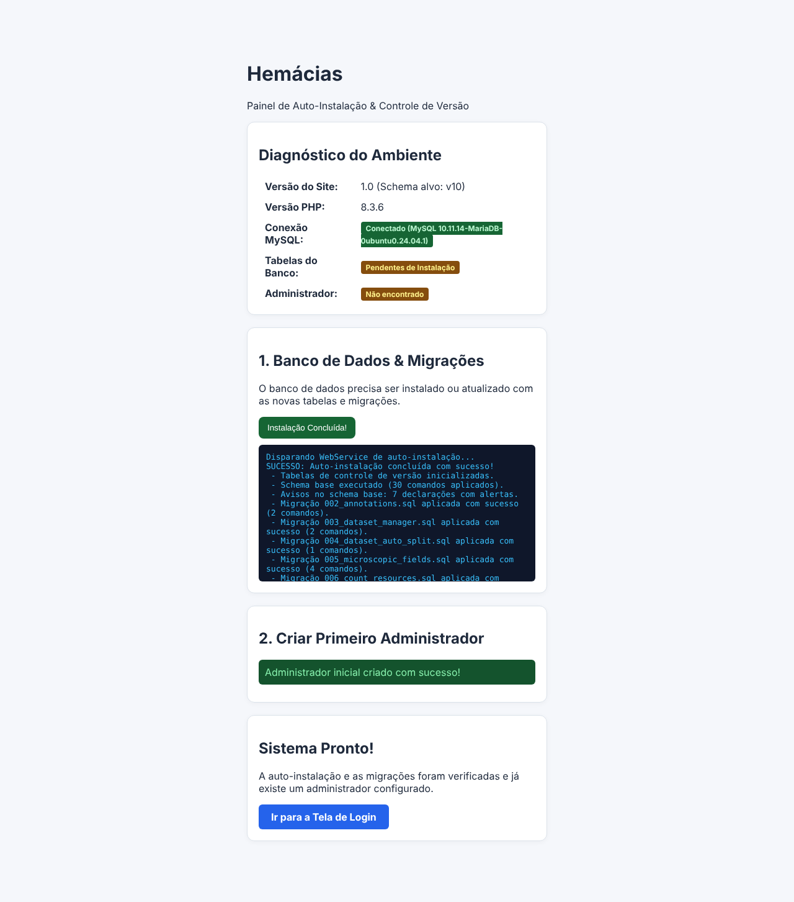

Nunca coloque o `config.php` no repositório: ele contém senhas e chaves. Os detalhes de hospedagem e segurança estão em [`web/README.md`](../web/README.md).

### 11.2 Entrar

Abra `index.php`, informe e-mail e senha e clique em **Entrar**.

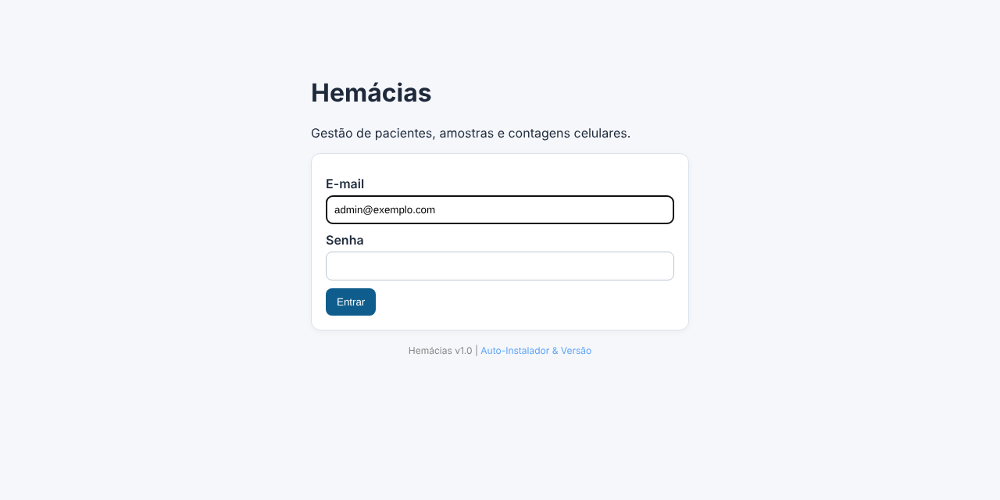

### 11.3 Perfis de usuário

| Perfil | O que pode fazer |
|---|---|
| **ADMIN** | Tudo, incluindo usuários, recursos, modelos de IA e sistema |
| **OPERADOR** | Cadastrar pacientes e amostras, registrar contagens, revisar campos e anotações |
| **LEITURA** | Só consultar |

O administrador cria usuários em **Usuários**. A senha precisa ter pelo menos 10 caracteres.

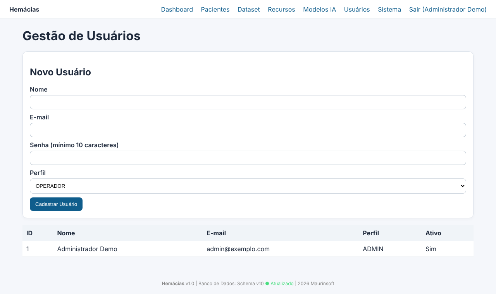

### 11.4 Painel inicial

O **Dashboard** mostra o total de pacientes, amostras, contagens e imagens. O rodapé informa a versão do sistema e se o banco está atualizado.

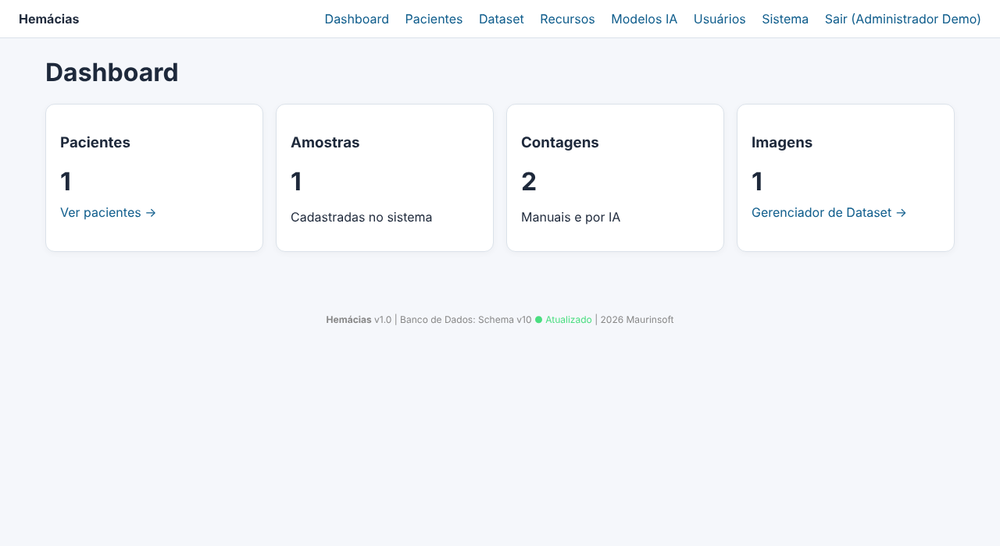

### 11.5 Pacientes e amostras

Em **Pacientes**, cadastre um paciente novo ou pesquise por nome ou identificador.

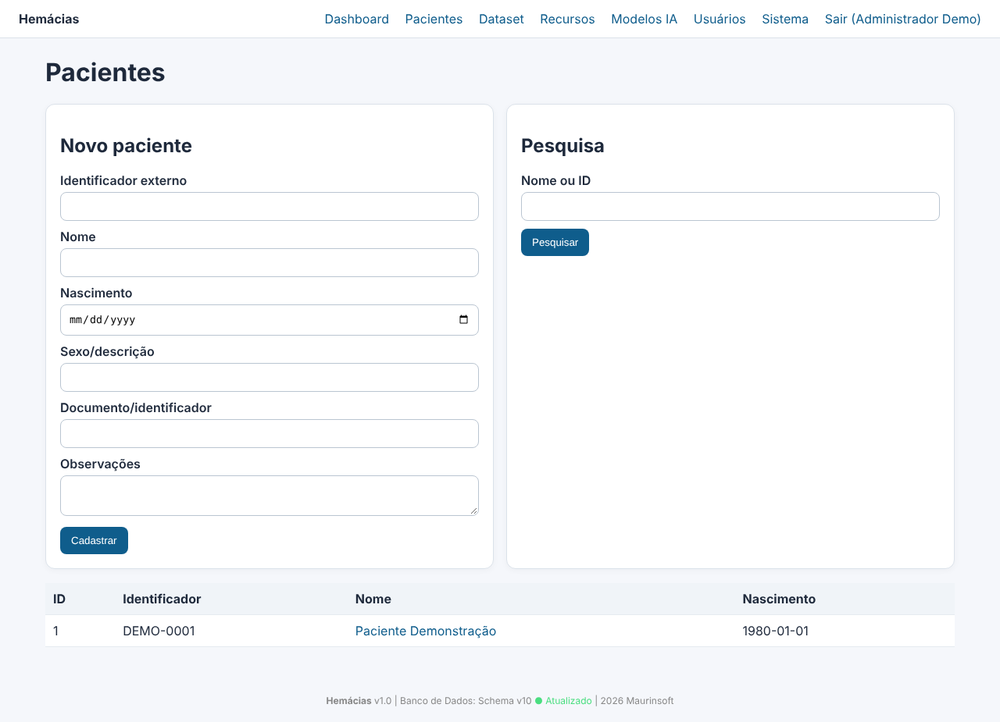

Clique no nome para abrir o paciente. Ali se cria uma **Nova amostra**, com código, data de coleta, tipo e protocolo.

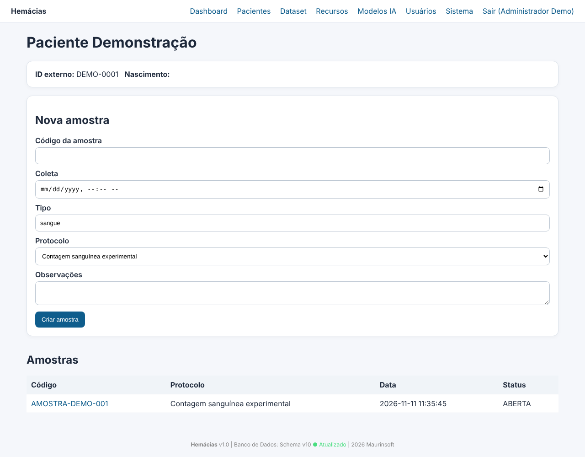

> Prefira um identificador interno ao CPF ou a outro dado sensível, sempre que um código bastar.

### 11.6 A página da amostra

Clique no código da amostra para abri-la. A página reúne:

- **Contagem Manual**: para registrar uma contagem feita no olho, escolhendo o componente e informando quantidade, escala e magnificação;
- **Contagens Realizadas**: todas as contagens da amostra, com o método e a origem (`WEB` para as manuais, `LAZARUS` para as do Hemácias Analyzer, `PYTHON` para as do contador em tempo real);
- **Imagens da Amostra**: as imagens enviadas; clique no nome para ver a imagem.

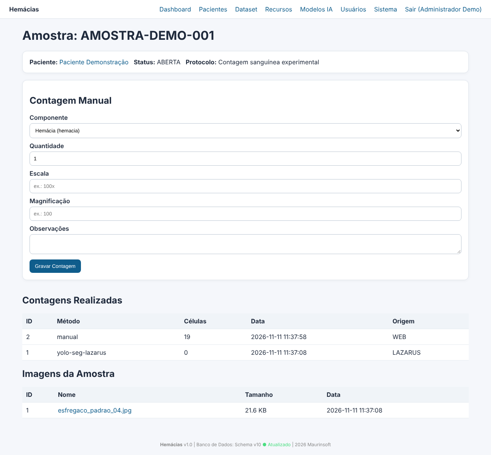

### 11.7 Análise consolidada da amostra

O endereço `sample_analysis.php?sample_id=ID` (troque `ID` pelo número da amostra) mostra o resumo dos campos microscópicos.

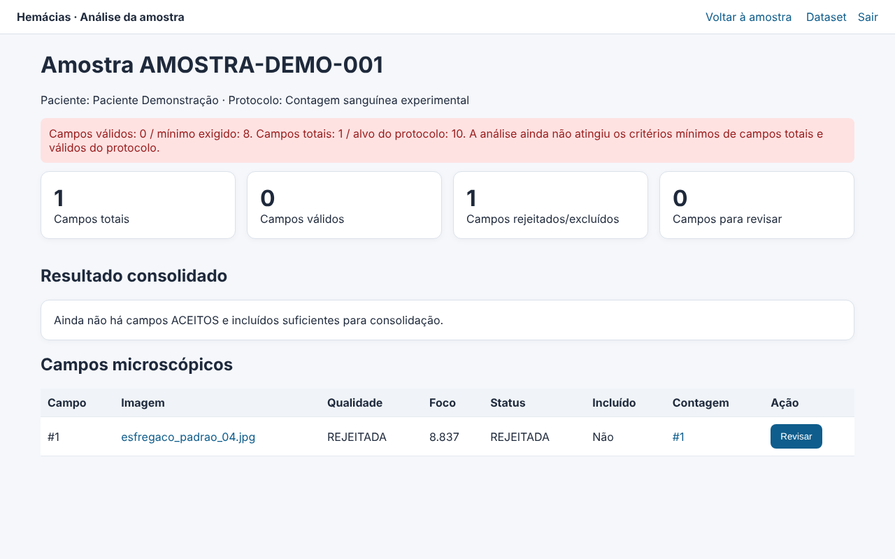

A página traz o total de campos, os válidos, os rejeitados e os que aguardam revisão; por componente, a média, a mediana, o mínimo, o máximo e o desvio-padrão; e a lista dos campos, com qualidade, foco e estado. O aviso em vermelho aparece enquanto a amostra não atinge o mínimo do protocolo.

O botão **Revisar** de cada campo permite mudar o estado (ACEITA, REVISAR ou REJEITADA) e decidir se o campo entra no consolidado. Campos rejeitados ficam de fora por padrão.

### 11.8 Dataset

A página **Dataset** organiza as imagens que servirão para treinar e validar modelos.

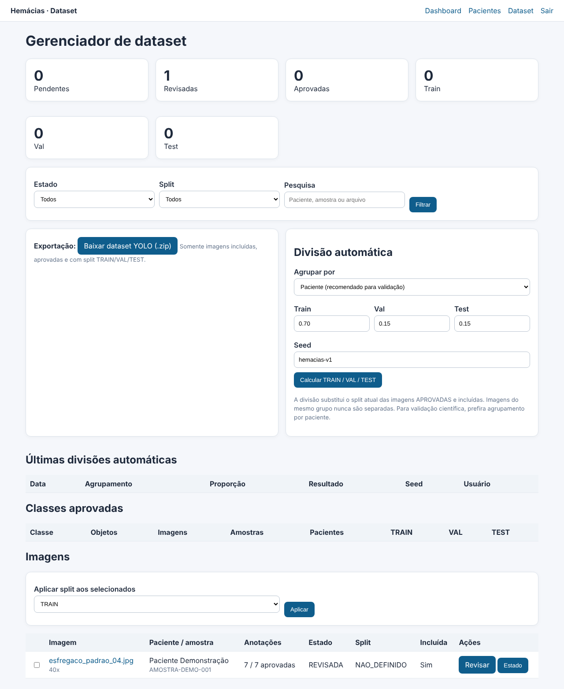

Cada imagem passa por estes estados:

```text
detecção importada        → PENDENTE
revisão manual salva      → REVISADA
aprovação no gerenciador  → APROVADA
```

Na página é possível:

- filtrar por estado, divisão e texto;
- abrir a anotação da imagem, com **Revisar**;
- mudar o estado e a divisão de uma imagem, com **Estado**;
- aplicar TRAIN, VAL ou TEST a várias imagens de uma vez;
- fazer a **Divisão automática**, agrupando por paciente ou por amostra, para que imagens do mesmo grupo nunca caiam em conjuntos diferentes;
- baixar o dataset no formato YOLO, com **Baixar dataset YOLO (.zip)**.

Só entram na exportação as imagens aprovadas, incluídas e com divisão definida. A exportação é bloqueada se houver, por exemplo, o mesmo paciente em mais de um conjunto ou algum conjunto vazio.

### 11.9 Anotação de imagens

A tela de anotação abre pelo botão **Revisar** do dataset.

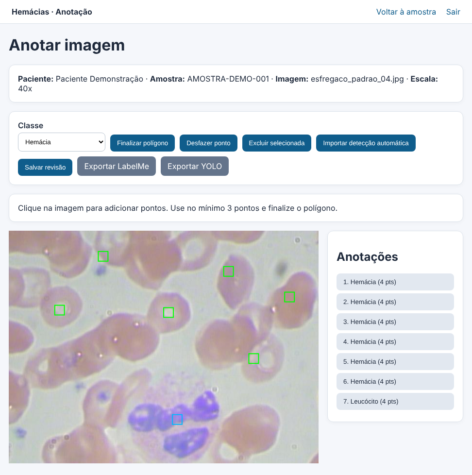

| Para | Faça |
|---|---|
| Desenhar uma célula | Escolha a **Classe**, clique nos pontos do contorno (no mínimo três) e clique em **Finalizar polígono** |
| Desfazer o último ponto | **Desfazer ponto** |
| Apagar uma anotação | Clique nela na lista **Anotações** e depois em **Excluir selecionada** |
| Trazer as detecções automáticas | **Importar detecção automática** |
| Gravar | **Salvar revisão** |
| Levar para outra ferramenta | **Exportar LabelMe** ou **Exportar YOLO** |

A revisão é gravada sem alterar o resultado automático original.

### 11.10 Recursos (administrador)

Em **Recursos** ficam os **componentes de contagem** (hemácia, leucócito, plaqueta, artefato, outro e os que você criar) e os **protocolos**.

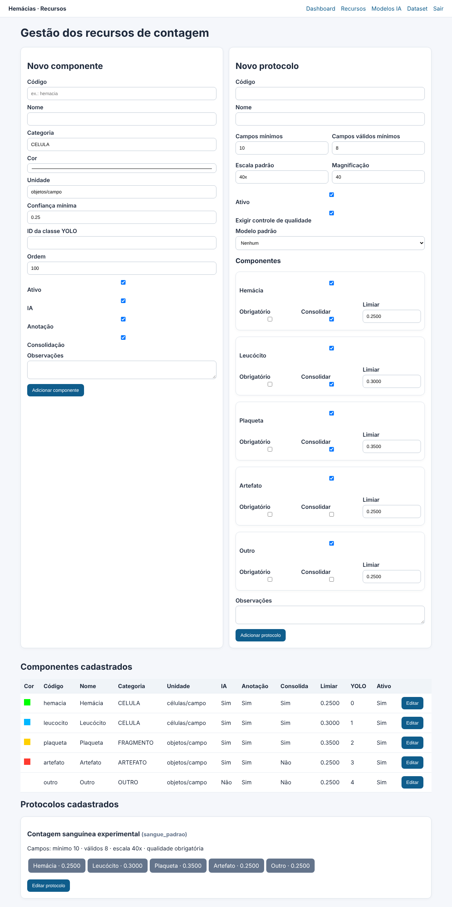

Cada componente tem código, nome, cor, unidade, limiar mínimo de confiança e o número da classe no modelo YOLO. Cada protocolo define quais componentes participam, quantos campos são exigidos, a escala padrão e se o controle de qualidade é obrigatório.

### 11.11 Modelos de IA (administrador)

Em **Modelos IA** registra-se cada versão de modelo: código, nome, versão, tipo, caminho do arquivo, SHA-256, dataset de origem e classes.

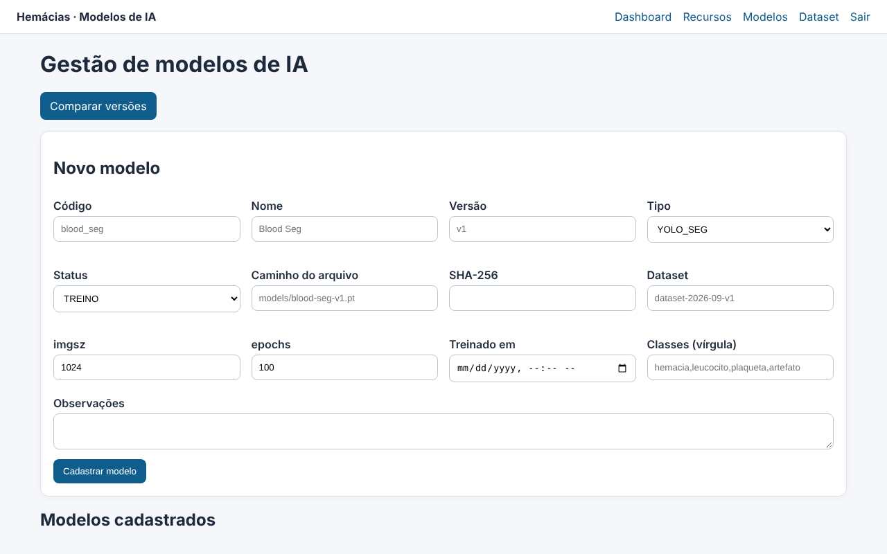

| Estado do modelo | Significado |
|---|---|
| **TREINO** | Em treinamento; não pode ser usado em contagens |
| **VALIDACAO** | Liberado para uso, em avaliação |
| **APROVADO** | Aprovado por decisão do administrador |
| **INATIVO** | Fora de uso |

**Comparar versões** mostra dois ou mais modelos lado a lado, com suas métricas. Nenhuma tela promove um modelo sozinha: passar para **APROVADO** é sempre uma decisão explícita do administrador.

### 11.12 Sistema (administrador)

O item **Sistema** abre o painel de instalação, que também serve para conferir a versão e aplicar migrações pendentes depois de uma atualização.

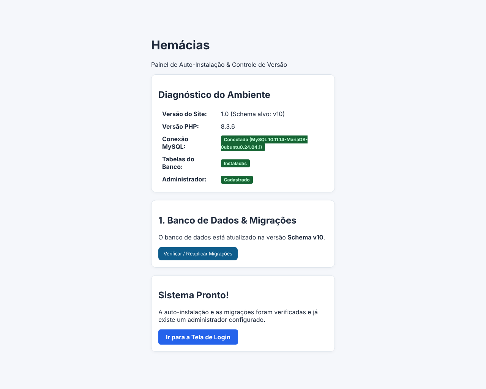

## 12. Contador em tempo real

Para contar ao vivo, sem o aplicativo de mesa, use o programa `teste04.py`, na pasta principal do repositório.

```bash
python teste04.py --list-videos     # mostra as câmeras disponíveis
python teste04.py --index 0         # inicia com a câmera 0
```

Uma janela mostra a imagem da câmera com as células marcadas, a contagem e o estado de qualidade.

| Tecla | Ação |
|---|---|
| `Q` | Sair |
| `C` | Zerar o histórico da contagem |
| `S` | Gravar a contagem e a imagem no servidor |

A tecla `S` só funciona quando o programa é iniciado com o endereço e a chave do servidor:

```bash
python teste04.py \
  --api-url https://servidor/hemacias/web \
  --api-key SUA_CHAVE \
  --patient-name "Nome do paciente" \
  --sample-code AMOSTRA-0001
```

Para contar hemácias, leucócitos e plaquetas com um modelo de IA:

```bash
python teste04.py --method yolo --model models/blood-cell-bccd-yolov8s.pt
```

A lista completa de opções está no [Guia técnico](GUIA_TECNICO.md#contador-em-tempo-real).

## 13. Solução de problemas

### Hemácias Analyzer

| Sintoma | Causa provável | O que fazer |
|---|---|---|
| Barra de status mostra `Python indisponível` | Python ausente ou fora do PATH | Instale o Python 3.10 ou superior com **Add python.exe to PATH** e rode o instalador de dependências |
| `Python não está inicializado` ao clicar em **Analisar** | O mesmo | O mesmo; reabra o programa depois |
| `Falha na análise: …` | Biblioteca de IA não instalada ou modelo inválido | Rode **Instalar Dependencias de IA e Camera (Python)**; confira o campo **Modelo** |
| `Modelo não encontrado: …` | Caminho do modelo errado | Clique em **Selecionar** e aponte para um arquivo `.pt` da pasta `models` |
| `Campo rejeitado pelo controle de qualidade` | Imagem fora de foco ou mal iluminada | Veja o [capítulo 6](#6-controle-de-qualidade-da-imagem) |
| Nenhuma célula detectada | Confiança alta demais, modelo inadequado ou células muito pequenas | Reduza a **Confiança**, aumente o **imgsz** ou troque o modelo |
| Muitas detecções falsas | Confiança baixa demais | Aumente a **Confiança** e exclua as falsas na revisão |
| `Nenhuma câmera encontrada` | Câmera desligada, sem driver ou em uso por outro programa | Feche o programa do fabricante da câmera, confira o cabo e clique em **Atualizar** |
| `Falha ao capturar imagem da câmera` | Câmera ocupada ou resolução não suportada | Feche outros programas que usem a câmera e tente de novo |
| Medidas em µm absurdas | Objetiva errada ou escala não calibrada | Confira a **Objetiva** e refaça a [calibração](#7-escala-e-calibração) |
| A escala não muda ao trocar a objetiva | Já existe calibração por régua ativa | É o esperado; para voltar à escala teórica, feche e reabra o programa |
| `Falha na API: …` ao conectar | Endereço ou chave incorretos, servidor fora do ar | Confira **API URL** e **API key**; teste o endereço no navegador |
| `Vincule paciente e amostra antes de enviar` | Amostra não vinculada | Faça o passo [10.2](#102-vincular-paciente-e-amostra) |
| `Envie o campo ao servidor antes de salvar a revisão` | A revisão depende do campo já gravado | Clique em **Enviar campo** e depois em **Salvar revisão no dataset** |
| `O arquivo de modelo local não corresponde ao SHA-256 configurado no protocolo` | O arquivo local não é o modelo cadastrado | Peça ao administrador o arquivo correto do modelo |
| **Parecer com IA** sempre apagado | Componente de texto por IA sem configuração | Veja a seção [8.4](#84-aba-relatório) |
| Letras acentuadas aparecem como `?` em alguns botões e mensagens | Limitação da versão 1.2 | Não afeta o funcionamento; por exemplo, "Calibrar por r?gua" é "Calibrar por régua" |

### Gerenciador web

| Sintoma | O que fazer |
|---|---|
| `Arquivo web/config.php não encontrado` | Copie `config.example.php` para `config.php` e preencha |
| Tela de entrada avisa que o banco não foi inicializado | Abra `install.php` e clique em **Instalar Banco Automaticamente** |
| `Usuário ou senha inválidos` | Confira o e-mail e a senha; peça ao administrador para recriar o acesso |
| `Token CSRF inválido ou expirado` | Recarregue a página e tente de novo |
| `Perfil somente leitura` | Seu usuário tem o perfil LEITURA; peça outro perfil ao administrador |
| Rodapé mostra **Atualização Pendente** | Entre em **Sistema** e clique em **Verificar / Reaplicar Migrações** |
| Exportação do dataset bloqueada | Leia a lista de pendências exibida: paciente em mais de um conjunto, conjunto vazio, anotação pendente ou classe sem número YOLO |

### Contador em tempo real

| Sintoma | O que fazer |
|---|---|
| `Nenhum dispositivo de vídeo encontrado` | Confira a câmera e rode `python teste04.py --list-videos` |
| `--api-url e --api-key devem ser informados juntos` | Informe os dois ou nenhum |
| `Campo bloqueado pelo controle de qualidade` ao teclar `S` | Melhore foco e iluminação |
| `modelo YOLO não encontrado` | Confira o caminho passado em `--model` |

## 14. Glossário

| Termo | Significado |
|---|---|
| **Campo microscópico** | Uma imagem de uma região da lâmina. Uma amostra é avaliada por vários campos |
| **Componente** | O que se conta: hemácia, leucócito, plaqueta, artefato |
| **Confiança** | Grau de certeza do modelo em cada detecção, de 0 a 1 |
| **Dataset** | Conjunto de imagens anotadas, usado para treinar e avaliar modelos |
| **Detecção** | Um objeto encontrado pelo modelo na imagem |
| **Diâmetro equivalente** | Diâmetro do círculo com a mesma área da célula |
| **Esfregaço** | Fina camada de sangue espalhada e corada sobre a lâmina |
| **Hemácia (RBC)** | Glóbulo vermelho |
| **Leucócito (WBC)** | Glóbulo branco |
| **Modelo** | Arquivo `.pt` com a rede neural treinada |
| **Morfometria** | Medição do tamanho e da forma das células |
| **Plaqueta** | Fragmento celular ligado à coagulação |
| **Protocolo** | Regra de contagem da amostra: componentes, número de campos, escala e modelo |
| **Régua micrométrica** | Lâmina com uma escala gravada de comprimento conhecido, usada para calibrar |
| **TRAIN, VAL, TEST** | Conjuntos de treino, validação e teste em que o dataset é dividido |
| **VCM, HCM, CHCM** | Volume corpuscular médio, hemoglobina corpuscular média e concentração de hemoglobina corpuscular média |
| **YOLO** | Família de redes neurais para detecção de objetos em imagens |

## 15. Limites do sistema

- A contagem é feita por campo de imagem. Ela não equivale à contagem de células por volume de sangue feita por um contador hematológico.
- A qualidade do resultado depende do foco, da iluminação, da coloração da lâmina e de o modelo ter sido treinado com imagens parecidas com as suas.
- As medidas em micrômetros só são confiáveis depois da calibração por régua, com a mesma objetiva, adaptador e câmera.
- O CV do diâmetro medido na imagem não é o RDW.
- VCM, HCM e CHCM vêm exclusivamente dos valores de laboratório que você digita.
- Um modelo novo deve ser avaliado em imagens que não participaram do treino antes de ser usado.
- O sistema guarda dados de pacientes. Siga a política de proteção de dados da sua instituição: acesso restrito, HTTPS, cópias de segurança protegidas e nenhum dado real em repositórios de código.
